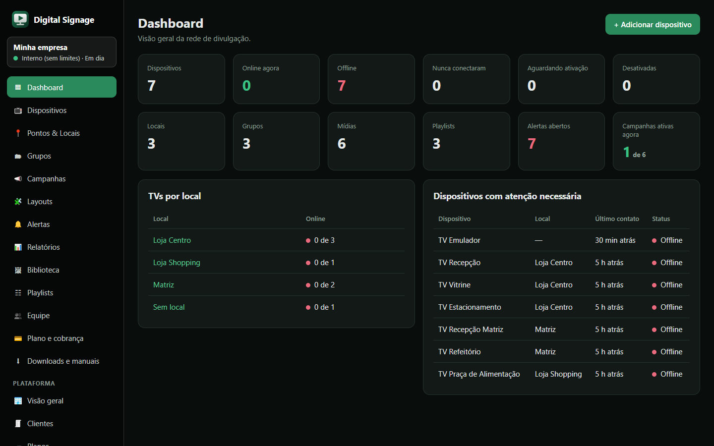
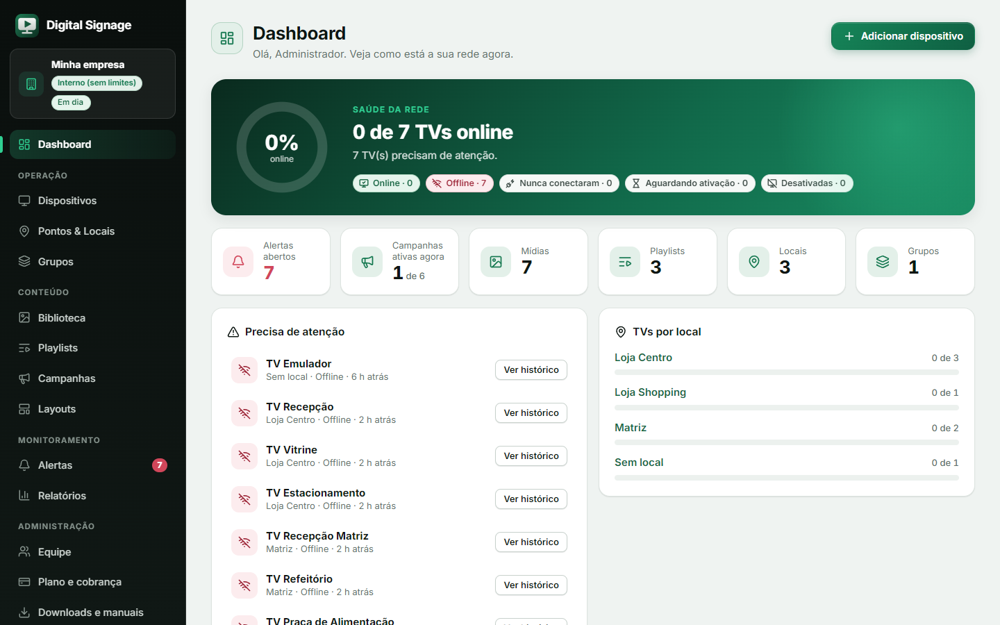
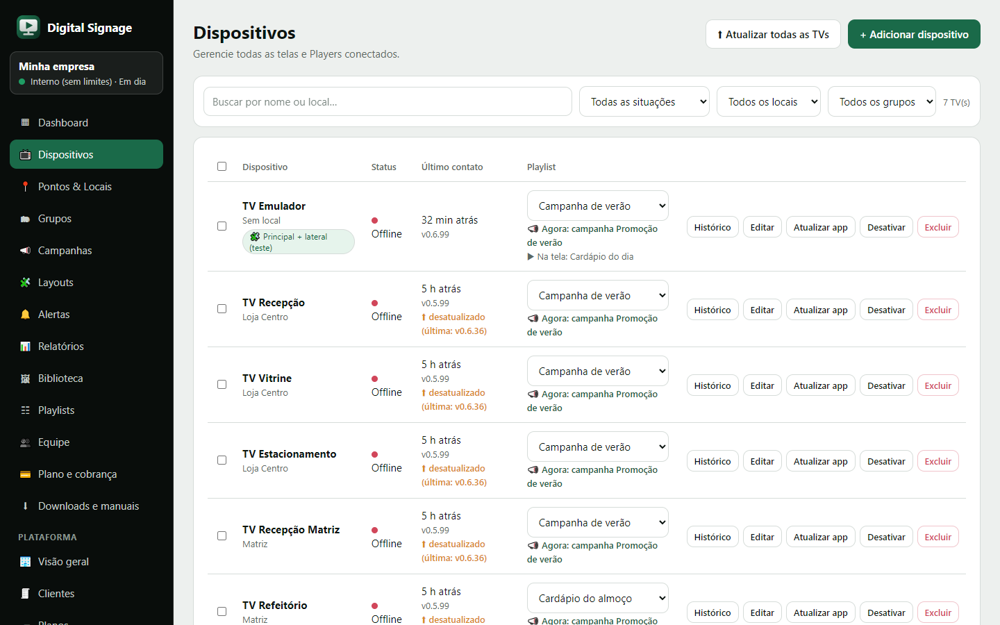
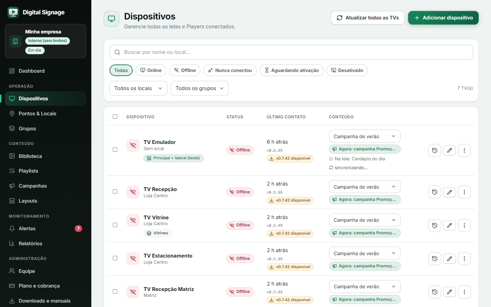
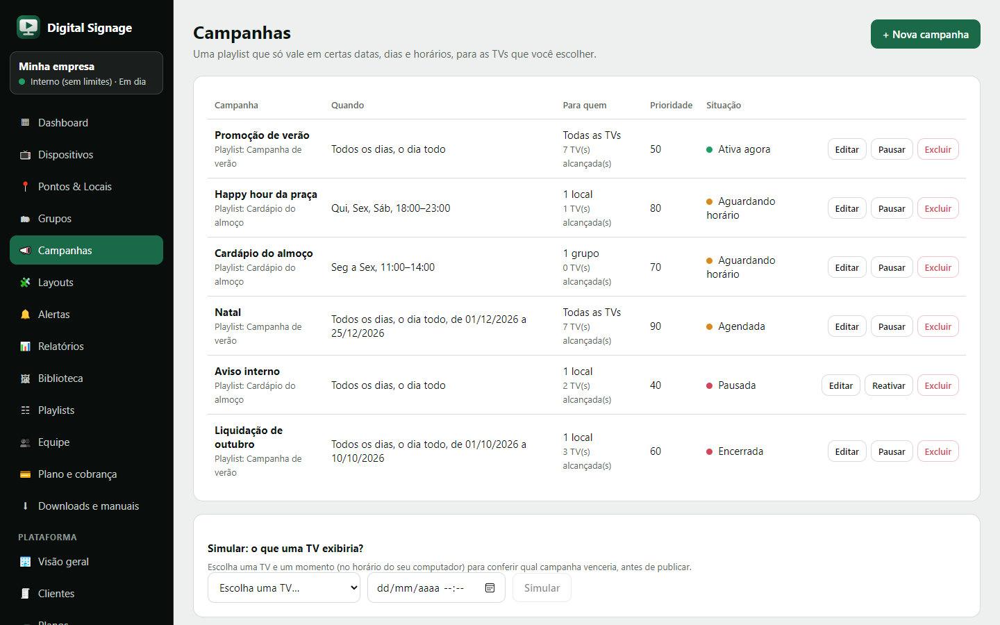
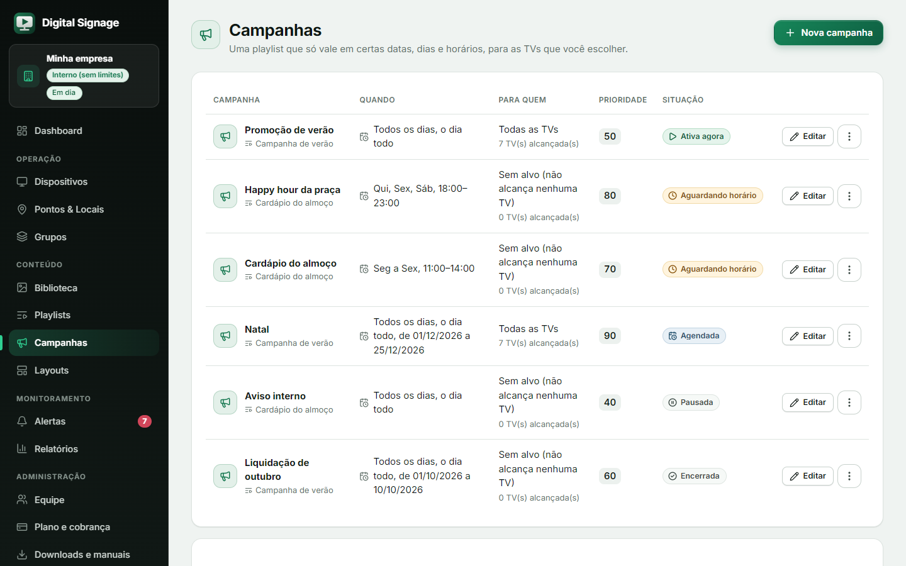
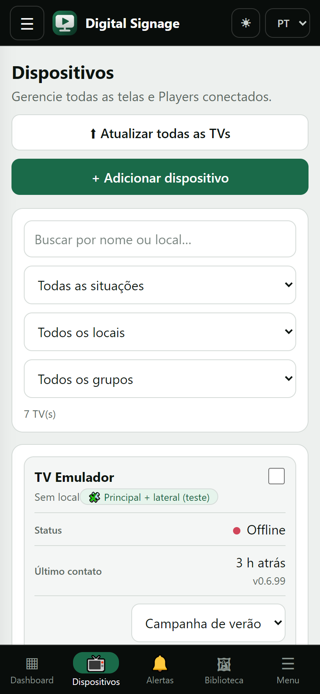
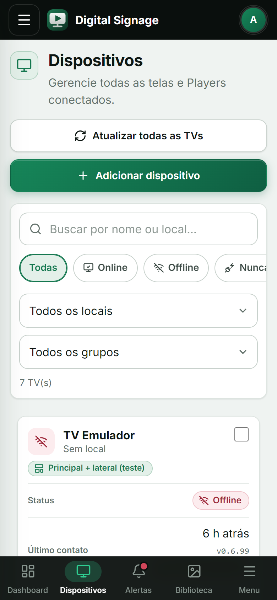

# Revisão de UX/UI do painel

Revisão feita com o olhar de **UX/UI sênior** junto com um **tech lead de frontend**: o que estava fraco, o que a pesquisa
indica, o que foi decidido e como ficou. Vale como guia de manutenção: quem for criar uma tela nova deve seguir os
princípios, os componentes e a política de ícones daqui.

> Resumo: o painel deixou de ser "um formulário com tabelas" e passou a **mostrar primeiro o que importa** (quais TVs estão
> no ar e o que precisa de atenção), **ensinar o próximo passo** quando não há dados, **tirar o ruído** das linhas (uma ação
> principal + menu "mais ações") e **nunca depender só de cor ou de emoji**. Todos os ícones são gratuitos (Lucide) e embutidos
> no código.

| Antes | Depois |
|---|---|
|  |  |
|  |  |
|  |  |
|  |  |

Mais telas: [login](design/after/login.png), [login escuro](design/after/login-escuro.png),
[login no celular](design/after/login-celular.png), [dashboard escuro](design/after/dashboard-desktop-escuro.png),
[dashboard no celular](design/after/dashboard-celular.png), [dispositivos no celular escuro](design/after/dispositivos-celular-escuro.png),
[biblioteca](design/after/biblioteca-desktop.png), [layouts](design/after/layouts-desktop.png),
[relatórios escuro](design/after/relatorios-desktop-escuro.png), [plano e cobrança](design/after/plano-desktop.png).

## 1. Diagnóstico (o que havia)

Auditoria das telas anteriores, com a gravidade de cada achado:

| # | Achado | Por que importa | Gravidade |
|---|---|---|---|
| 1 | **Emoji como ícone** (✅ 🟢 🔴 ⏸ ▶ 🎞 📣 🌐 ▦ ⬆ ⚠ ✕…) | Muda de desenho em cada sistema (Windows, Android, iOS, Fire TV), não herda a cor do tema, tem peso visual diferente do texto e o leitor de tela o lê por extenso ("foguete") | Alta |
| 2 | **Situação só por bolinha colorida** (verde/laranja/vermelho) | Quem não distingue as cores perde a informação (WCAG 1.4.1, uso da cor) | Alta |
| 3 | **3 a 4 botões de texto por linha** de tabela (Editar, Desativar, Excluir, Atualizar app…) | Ruído: a ação principal some no meio das secundárias e as destrutivas ficam à mesma distância do dedo | Alta |
| 4 | **Estados vazios** eram uma frase cinza ("Nenhum local ainda…") e o carregamento era o texto "Carregando…" | Não ensinam o próximo passo; a tela parece quebrada enquanto carrega | Média |
| 5 | **Dashboard** era uma grade de números do mesmo peso | Não responde à pergunta principal ("está tudo no ar?") e não guia quem ainda não ativou nenhuma TV | Alta |
| 6 | **Alertas invisíveis** fora da tela de Alertas | Um problema só era descoberto abrindo a tela certa | Média |
| 7 | **Tema, idioma, senha e sair** espalhados (barra do topo, rodapé do menu, janela "Minha conta") | A pessoa não sabe onde procurar | Média |
| 8 | **Cabeçalhos de página** sem identidade (só título e frase) | Difícil situar-se; todas as telas pareciam iguais | Baixa |
| 9 | **Alvos de toque** menores que o recomendado em alguns botões | Erro de toque no celular, que é o uso principal | Média |
| 10 | **Contraste** do botão primário com gradiente claro (texto branco sobre `#1b9468` = 3,8:1) | Abaixo do mínimo AA (4,5:1) no canto mais claro | Média |

O que já estava bom e foi mantido: a base preta/prata (a marca mudou depois para violeta, veja `MARCA_VYZZU.md`), o modo escuro, as tabelas que viram cartões no celular, o idioma
PT/EN e a lógica de papéis (cada tela só mostra o que o papel pode fazer).

## 2. Princípios adotados

1. **O estado primeiro.** A primeira coisa da tela inicial é a saúde da rede (anel + "7 de 9 TVs online"), depois o que precisa de atenção.
2. **Estado = ícone + texto + cor** (nunca só cor). Selo (`app-pill`) em todo lugar: "Online", "Offline", "Ativa agora", "Aberto"…
3. **Uma ação principal por linha; o resto no menu "mais ações" (⋮).** Excluir sempre fica no menu, em vermelho, separado.
4. **Estado vazio que ensina:** ícone grande + o que vai aparecer ali + o próximo passo (botão). São três casos distintos:
   *primeiro uso* ("Nenhum local ainda" + botão), *filtro sem resultado* ("Limpar filtros") e *erro* (aviso no topo).
5. **Carregando = esqueleto** (`app-skeleton`: linhas cinza que brilham), nunca um texto solto.
6. **Consistência por componentes** (seção 5): a mesma coisa tem a mesma cara em todas as telas.
7. **Acessibilidade:** alvos de toque de 44 px no celular (o mínimo AA da WCAG 2.2 é 24 px; Apple pede 44 pt, Material 48 dp), foco visível com anel, `aria-label` em todo botão só de ícone, `aria-pressed`/`aria-expanded` nos controles de estado, contraste AA (seção 6), `prefers-color-scheme` e `prefers-reduced-motion` respeitados.
8. **Sem emoji. Só ícone gratuito.** Política na seção 4, garantida por teste.
9. **Celular primeiro:** cada tela foi conferida em 390 px antes de fechar (claro e escuro).

## 3. Arquitetura de informação

Menu lateral agrupado por **o que a pessoa vai fazer**, não por tabela do banco:

| Grupo | Telas |
|---|---|
| (topo) | Dashboard |
| **Operação** | Dispositivos, Pontos & Locais, Grupos |
| **Conteúdo** | Biblioteca, Playlists, Campanhas, Layouts |
| **Monitoramento** | Alertas (com **contador vermelho** dos alertas abertos), Relatórios |
| **Administração** | Equipe, Plano e cobrança, Downloads e manuais |
| **Plataforma** (só operador) | Visão geral, Clientes, Planos, Faturas, Configurações |

- **Cartão do cliente** no topo do menu (empresa + plano + situação da conta em selos).
- **Menu da pessoa** no pé do menu (avatar com iniciais): tema (Automático/Claro/Escuro), idioma, Minha conta e Sair, tudo num lugar só.
- **Celular:** barra no topo (☰, marca, avatar), **atalhos fixos na base** (Dashboard, Dispositivos, Alertas com ponto vermelho, Biblioteca, Menu) e o menu completo numa gaveta.
- O **contador de alertas** vem de `AttentionService`, que consulta o resumo a cada 30 s em silêncio (um erro de rede não gera aviso, só some o número).

## 4. Política de ícones

- **Biblioteca:** [Lucide](https://lucide.dev) (licença ISC; parte derivada do Feather, MIT). Gratuita, traço de 2 px, desenho consistente e mais de mil ícones.
- **Como entram:** um gerador (`frontend/scripts/generate-icons.mjs`) lê a lista de nomes e escreve `src/app/shared/icons.ts` com **o miolo do SVG de cada ícone**. Nada é baixado em tempo de execução e não há fonte de ícones: só os usados vão no pacote.
- **Como usar:** `<app-icon name="trash" />` (decorativo, some para o leitor de tela) ou `<app-icon name="trash" label="Excluir" />` (sozinho num botão). O tamanho vem de `[size]` e a cor é a do texto (`currentColor`), então o tema claro e o escuro funcionam sozinhos.
- **Para um ícone novo:** acrescente o nome na lista do gerador, rode `node scripts/generate-icons.mjs` e use. O tipo `IconName` impede um nome que não exista.
- **Proibido:** emoji e símbolos decorativos digitados no texto (setas, estrelas, quadrados, marcas de visto). `icon-policy.spec.ts` varre o código e **reprova** qualquer ocorrência (comentários não contam), confere que todo `icon="…"`/`name="…"` existe no registro e que as licenças estão em `frontend/THIRD_PARTY_NOTICES.md`.
- **Tipografia:** Inter (variável, OFL), hospedada junto do painel (`@fontsource-variable/inter`), com números tabulares (`.num`) para valores que se comparam.

## 5. Sistema de design

### Tokens (`frontend/src/styles.css`)
Toda cor, raio, sombra e movimento vem de variáveis CSS: tema claro em `:root`, escuro em `:root[data-theme='dark']`.
Nenhum componente usa cor fixa (exceções documentadas: cores das zonas na pré-visualização de layout, o QR Code e o hero do login/plano, que são sempre escuros).

| Grupo | Tokens |
|---|---|
| Superfície e texto | `--bg`, `--panel`, `--panel-2`, `--panel-3`, `--line`, `--line-strong`, `--text`, `--text-2`, `--muted`, `--silver` |
| Marca | `--primary` (violeta `#7c3aed`), `--violet`, `--magenta`, `--lavender`, `--primary-soft`, `--primary-line`, `--link`, `--accent`, `--grad-primary`, `--grad-hero`, `--glow`, `--nav-active` (valores e regras em `MARCA_VYZZU.md`) |
| Estados | `--ok-*`, `--warn-*`, `--err-*`, `--info-*` (fundo, texto e borda de cada) |
| Forma | `--r-sm` 8, `--r` 12, `--r-lg` 16, `--r-xl` 22 px |
| Elevação | `--sh-1`, `--sh-2`, `--sh-3`, `--ring` (foco) |

**Modo escuro** segue o que a prática recomenda: superfícies **mais claras quando mais elevadas** (não sombras pretas), cores de estado **dessaturadas** e com texto claro sobre fundo escuro do mesmo matiz, **bordas** em vez de sombras para separar blocos e o menu sempre escuro.

### Componentes (`frontend/src/app/shared`)
| Componente | Para quê |
|---|---|
| `app-icon` | Ícone (Lucide), decorativo ou com rótulo |
| `app-pill` | Selo de estado: ícone + texto + cor (`ok`, `warn`, `err`, `info`, `brand`, `neutral`); o texto longo vira reticências |
| `app-page-header` | Cabeçalho: ícone, título, explicação e as ações à direita (no celular as ações ocupam a largura) |
| `app-empty-state` | Estado vazio que ensina (ícone, título, texto, botão); `compact` para dentro de cartões |
| `app-skeleton` | Carregando (linhas que brilham; texto só para o leitor de tela) |
| `app-menu` | "Mais ações" (⋮): fecha ao clicar fora, em qualquer item ou com Esc; `aria-haspopup`/`aria-expanded` |
| `app-user-menu` | Menu da pessoa (avatar, tema, idioma, Minha conta, Sair) |
| `SITUATION`, `LEGACY_TONE`, `EVENT_LABELS` | Tabelas que ligam cada situação a ícone + tom (TV, fatura, campanha, evento) |

### Padrões por tipo de tela
- **Lista (tabela):** cabeçalho com ícone e botão principal · filtros em *chips* (com ícone) e busca · linha com ícone de contexto + nome em destaque + descrição · selo de situação · **Editar + ⋮**.
- **Cartões** (layouts, biblioteca): pré-visualização grande, nome, selos de fatos, ação principal + ⋮; elevação ao passar o mouse.
- **Formulários em janela:** título com ícone, campos 46 px (16 px de fonte no celular, para o iOS não dar zoom), ação principal à direita, "folha" colada na base no celular.
- **Relatórios:** abas em segmento com ícone, filtros em cartão, indicadores grandes antes da tabela.

## 6. Acessibilidade e contraste (medido)

Razão de contraste (WCAG: texto normal ≥ 4,5:1, texto grande e componentes ≥ 3:1), calculada a partir dos tokens:

| Par | Claro | Escuro |
|---|---|---|
| Texto / painel | 18,4:1 | 14,9:1 |
| Texto apagado / painel | 5,1:1 | 6,6:1 |
| Link / painel | 6,7:1 | 9,5:1 |
| Selo OK (texto / fundo) | 7,1:1 | 9,2:1 |
| Selo erro | 6,8:1 | 8,6:1 |
| Selo aviso | 6,0:1 | 9,5:1 |
| Selo informação | 7,7:1 | 8,6:1 |
| Menu lateral (texto / fundo) | 12,4:1 | — |
| Branco sobre o botão primário (ponto mais claro do degradê) | 4,6:1 | 4,7:1 |

Achado e correção: o degradê do botão primário começava em `#1b9468` (3,8:1) no claro e `#2fa874` (3,0:1) no escuro; os pontos
iniciais passaram a `#168659` e `#1f8458`, e o *hover* escurece (em vez de clarear) o botão.

Outros pontos: foco visível em tudo (anel de 3 px), `role="status"`/`role="alert"` nos avisos, `aria-live` na área de erros, rótulo
acessível em todo botão só de ícone, navegação pelo teclado nos menus (Esc fecha) e `aria-pressed` nos seletores segmentados.

## 7. Tratamento tela a tela

| Tela | O que mudou |
|---|---|
| Login | Dois painéis: marca e três benefícios (com ícones) à esquerda, formulário com ícones nos campos e botão "mostrar senha" à direita; no celular só o formulário |
| Dashboard | Anel de saúde da rede + selos por situação (clicáveis, já filtram Dispositivos); seis indicadores com ícone; "Precisa de atenção" com ação por TV; TVs por local em barras; **assistente de primeiros passos** (4 passos) quando ainda não há TV |
| Dispositivos | Busca + chips de situação + filtros; barra de ações em massa fixa; linha com ícone de estado, selos (layout, grupos, campanha, versão disponível), playlist na linha; Histórico, Editar e ⋮ (atualizar app, desativar/reativar, excluir) |
| Locais, Grupos | Ícone de contexto, contagem de TVs (link), selo "N de M online"; Editar + ⋮ |
| Campanhas | Selo de situação com ícone (ativa, aguardando, agendada, encerrada, pausada); prioridade em destaque; simulador com resultado em cartão; Editar + ⋮ (pausar/reativar, excluir) |
| Layouts | Cartões com o desenho da divisão da tela, selos de zonas e de TVs, Editar + ⋮ |
| Biblioteca | Cartões com miniatura, selo do tipo (imagem, vídeo, página), progresso de envio com ícone, ⋮ para excluir |
| Playlists / editor | Lista com duração do ciclo e versão em selos; editor com posição numerada, botões ↑ ↓ remover só de ícone (com rótulo), biblioteca com "+" ao passar o mouse |
| Alertas | Ícone de estado, selo "Aberto/Resolvido", situação do webhook; regras de aviso em cartão |
| Relatórios | Abas com ícone, indicadores grandes, barra de disponibilidade, selos de situação e de evento |
| Histórico da TV | Linha do tempo com ícone colorido por tipo/gravidade, selo de nível, faixa de fatos da TV |
| Equipe | Avatar com iniciais, selo do papel com ícone, cartões "o que cada papel pode" |
| Plano e cobrança | Cartão do plano em destaque (gradiente), uso x limite com barras, faturas com selo, planos com o atual marcado |
| Downloads | Versão em destaque com botão grande, instrução do Downloader em aviso, manuais como cartões, versões anteriores |
| Plataforma | Indicadores com ícone, selos de situação, ações em ⋮ |
| Avisos de erro | Ícone de alerta e botão "Fechar" com ícone (antes ⚠ e ✕) |

## 8. Verificação

- **437 testes do painel** (eram 412): componentes compartilhados (`ui.spec.ts`), menu da pessoa, `AttentionService`, política de ícones,
  cobertura de tradução (agora lê **todos** os componentes de cada arquivo, não só o primeiro) e as telas existentes adaptadas.
- **Capturas reais** (Edge) em 1440×900 e 390×844, claro e escuro, de todas as telas, e conferência no navegador integrado em 1280×800.
- **Achados da conferência, todos corrigidos:** a tabela de Dispositivos passava de 1280 px e rolava a página para o lado
  (menu mais estreito abaixo de 1400 px, "Editar" só com o lápis abaixo de 1500 px, selos com reticências); no celular, a célula da
  playlist alargava a página; o painel do menu da pessoa era cortado pela rolagem do menu lateral (passou a `position: fixed`);
  itens "Excluir" dos menus herdavam o estilo de botão e ficavam centralizados; ícones dentro de selos encostavam no texto;
  botões do cabeçalho não ocupavam a largura no celular; contraste do botão primário (seção 6).

## 9. Fora do escopo e próximos passos

- Não há **testes visuais automáticos** (comparação de imagem): a conferência é por captura e olho humano. Se o painel crescer, vale
  adicionar Playwright com *screenshots* de referência.
- **Reordenar por arrastar** (playlist, zonas do layout) ficou fora: continua por setas, que funcionam em qualquer aparelho.
- A tabela de Dispositivos é a mais densa; se ganhar mais colunas, o caminho é o modo "cartões" também em telas médias.
- Os manuais em PDF e as capturas deles acompanham a nova aparência (ver `DECISIONS.md`, parte 11).

## 10. Referências consultadas

- WCAG 2.2: critérios 1.4.1 (uso da cor), 1.4.3 (contraste mínimo), 2.4.7 (foco visível), 2.5.8 (tamanho do alvo) — <https://www.w3.org/TR/WCAG22/>
- Nielsen Norman Group: dez heurísticas de usabilidade (visibilidade do estado do sistema, reconhecimento em vez de memorização) e orientações para estados vazios — <https://www.nngroup.com/articles/ten-usability-heuristics/>
- Apple Human Interface Guidelines (alvo de toque de 44 pt) e Material Design (48 dp; superfícies mais claras com a elevação no tema escuro)
- Lucide (<https://lucide.dev>) e Inter (<https://rsms.me/inter/>), com as licenças em `frontend/THIRD_PARTY_NOTICES.md`
- Painéis de sinalização digital do mercado, como referência de informação prioritária: o estado de cada tela e a próxima ação sugerida
