# Manual de instalação do Player

Como instalar o aplicativo **Smartplay** em uma **TV TCL com Android TV** e em um **Fire TV Stick**, ativar a TV no painel e deixá-la exibindo as propagandas.

> **Importante:** o Player não vem da Google Play nem da Amazon Appstore. Ele é um arquivo **APK** que você baixa do nosso site e instala direto na TV. Depois de instalado, ele se atualiza sozinho pelo mesmo site (veja a [seção 6](#6-atualizacao-automatica)).

**Endereços que você vai usar**

| O quê | Endereço |
|---|---|
| Painel (onde você gerencia as TVs) | `https://signage-painel.pages.dev` |
| Download do Player (lista de versões) | `https://signage-downloads.pages.dev` |
| Atalho curto para baixar a versão mais recente | `signage-downloads.pages.dev/d` |

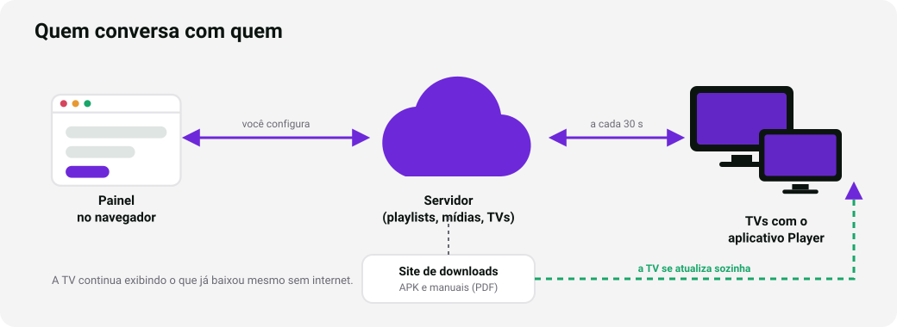

---

## 1. Antes de começar

**Você vai precisar de:**

- [ ] A TV (TCL Android TV) ou o Fire TV Stick, **ligados e conectados à internet** (Wi‑Fi ou cabo).
- [ ] O controle remoto da TV, com pilhas boas.
- [ ] Acesso ao painel: o e-mail e a senha de administrador.
- [ ] Um celular ou computador para abrir o painel e digitar o código de ativação.
- [ ] Para o método com computador (opcional): um PC Windows na **mesma rede** da TV.

**Como o processo funciona, em 4 passos:**

1. Instalar o Player na TV.
2. Abrir o Player: ele mostra na tela um **código de 6 letras/números**.
3. No painel: **Dispositivos → Adicionar dispositivo** e digitar o código.
4. No painel: enviar as mídias, montar uma **playlist** e escolhê-la para a TV.

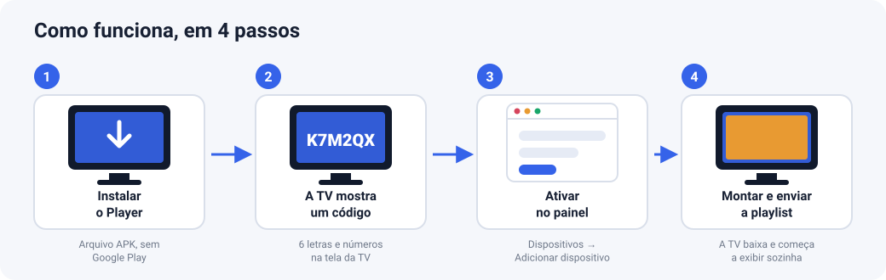

**Dois caminhos para instalar:**

| | Método A — Downloader | Método B — ADB (com PC) |
|---|---|---|
| Precisa de computador | Não | Sim |
| Dificuldade | Fácil | Média |
| Permite liberar todas as permissões | Em parte (depende dos menus da TV) | **Sim, todas** |
| Recomendado para | A primeira instalação, TVs de clientes | Quando algum menu não existir na TV |

> Os nomes dos menus mudam conforme o modelo e a versão do Android/Fire OS. Os caminhos abaixo são os **típicos**; se o seu for um pouco diferente, procure pelo nome da opção (por exemplo, "Fontes desconhecidas" ou "Instalar apps desconhecidos").

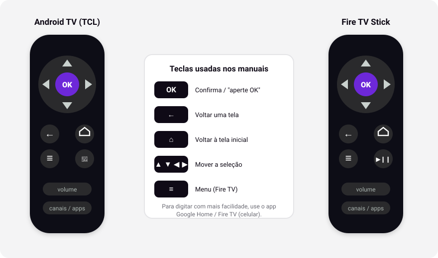

---

## 2. TV TCL com Android TV

### 2.1 Ligar as opções de desenvolvedor (só se for usar o método B)

1. Na tela inicial, abra **Configurações** (ícone de engrenagem).
2. Vá em **Preferências do dispositivo → Sobre**.
3. Role até **Compilação** (às vezes "Build" ou "Versão do SO") e aperte **OK 7 vezes seguidas**. Aparece "Agora você é um desenvolvedor".
4. Volte um nível. Surgiu **Opções do desenvolvedor**. Entre e ligue **Depuração USB**. Se existir **Depuração de rede** (ou "ADB por rede"), ligue também.

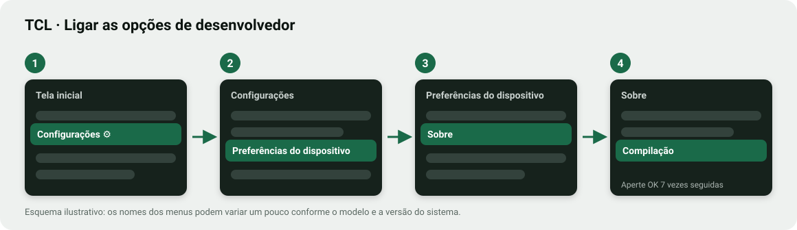

### 2.2 Método A — instalar com o app Downloader (sem computador)

**Passo 1 — Instale o Downloader na TV.**

1. Na tela inicial, abra a **Google Play Store** da TV.
2. Pesquise por **Downloader** (ícone laranja, do desenvolvedor *AFTVnews*).
3. Clique em **Instalar** e depois em **Abrir**. Na primeira abertura ele pede permissão para acessar arquivos: **Permitir**.

**Passo 2 — Deixe o Downloader instalar apps de fora da loja.**

1. **Configurações → Preferências do dispositivo → Segurança e restrições → Fontes desconhecidas** (em algumas TVs: **Configurações → Apps → Acesso especial → Instalar apps desconhecidos**).
2. Ligue a chave do **Downloader**.

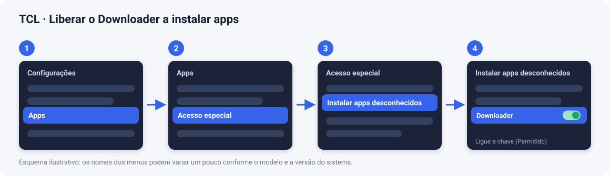

> Se você pular este passo, a TV avisa na hora da instalação e oferece um atalho para essa tela.

**Passo 3 — Baixe o Player.**

1. Abra o **Downloader**.
2. No campo de endereço, digite exatamente: `signage-downloads.pages.dev/d` e escolha **Ir** (Go).
3. O arquivo `player-….apk` é baixado (cerca de 6 MB).
4. Quando terminar, clique em **Instalar**.
5. Ao final, escolha **Concluído** (não precisa abrir ainda) e, se o Downloader perguntar se quer apagar o arquivo, escolha **Excluir** para liberar espaço.

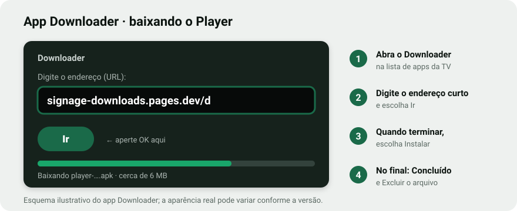

> **Digitar com o controle é lento.** Dica: o app **Google Home** no celular, ou o controle remoto virtual do Android TV, permite digitar com o teclado do celular.

### 2.3 Permissões do Player (importante)

Depois de instalado, o Player precisa de **duas permissões** que o Android não concede sozinho. Sem elas ele funciona, mas perde dois recursos:

| Permissão | Para quê | Sem ela |
|---|---|---|
| **Instalar apps desconhecidos** | Atualizar o Player sozinho | O Player não se atualiza; você precisa reinstalar à mão |
| **Exibir sobre outros apps** | Abrir sozinho quando a TV liga (e depois de cada atualização) | Depois de ligar a TV você precisa abrir o Player manualmente |

**Como liberar pelos menus da TV:**

1. **Configurações → Apps → Acesso especial** (ou "Acesso especial de apps").
2. Entre em **Instalar apps desconhecidos**, escolha **Smartplay** e ligue.
3. Volte e entre em **Exibir sobre outros apps**, escolha **Smartplay** e ligue.


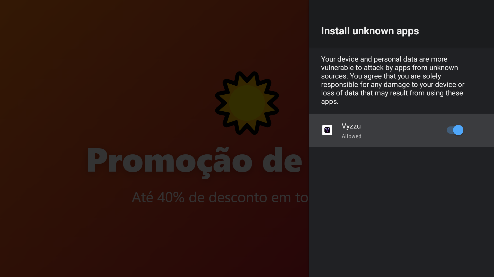

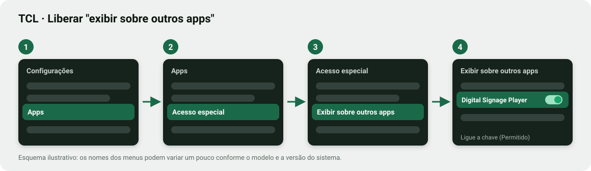

**Se a sua TV não tiver esses menus** (acontece em algumas TCL), use o **método B** abaixo: dois comandos resolvem.

<a id="24-metodo-b-instalar-com-o-computador-adb"></a>

### 2.4 Método B — instalar com o computador (ADB)

Este método funciona em **qualquer** TV Android e libera todas as permissões.

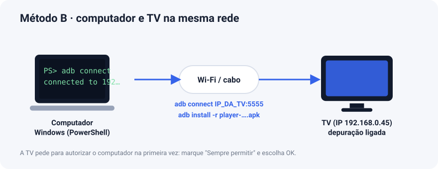

**Passo 1 — Prepare o computador (uma vez só).**

1. Baixe o **SDK Platform‑Tools** (que traz o `adb`) no site oficial: <https://developer.android.com/tools/releases/platform-tools>.
2. Extraia o ZIP em uma pasta, por exemplo `C:\platform-tools`.
3. Abra o **PowerShell** nessa pasta (na pasta: segure **Shift**, clique com o botão direito num espaço vazio e escolha "Abrir janela do PowerShell aqui").

**Passo 2 — Descubra o endereço da TV.**

Na TV: **Configurações → Rede e Internet** → toque na rede conectada → anote o **Endereço IP** (algo como `192.168.0.45`).

**Passo 3 — Baixe o APK no computador.**

Abra <https://signage-downloads.pages.dev> no navegador, clique em **Baixar APK** e salve na pasta `C:\platform-tools`.

**Passo 4 — Conecte e instale.** Troque `IP_DA_TV` e o nome do arquivo:

```powershell
.\adb connect IP_DA_TV:5555
.\adb install -r player-0.3.0.apk
```

A TV mostra uma janela **"Permitir depuração USB?"** com o código do seu computador: marque **Sempre permitir** e escolha **OK**. Rode o `adb connect` de novo, se for preciso.

Se aparecer `Success`, está instalado.

**Passo 5 — Libere as permissões e abra o app.**

```powershell
.\adb shell appops set com.digitalsignage.player REQUEST_INSTALL_PACKAGES allow
.\adb shell appops set com.digitalsignage.player SYSTEM_ALERT_WINDOW allow
.\adb shell am start -n com.digitalsignage.player/.MainActivity
```

<a id="25-ativar-a-tv-e-exibir-as-propagandas"></a>

### 2.5 Ativar a TV e exibir as propagandas

1. A TV mostra **"Código de ativação"** com 6 caracteres grandes. Anote.

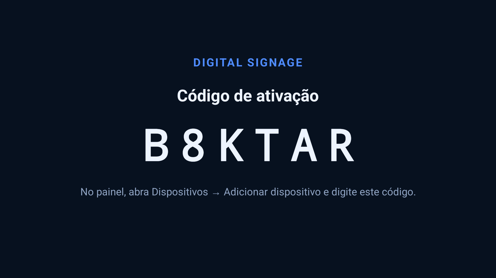

2. No celular ou computador, abra `https://signage-painel.pages.dev` e entre.
3. Vá em **Dispositivos → Adicionar dispositivo**.
4. Digite o **código**, dê um **nome** (ex.: "TV Recepção"), informe o **local** e clique em **Ativar dispositivo**.

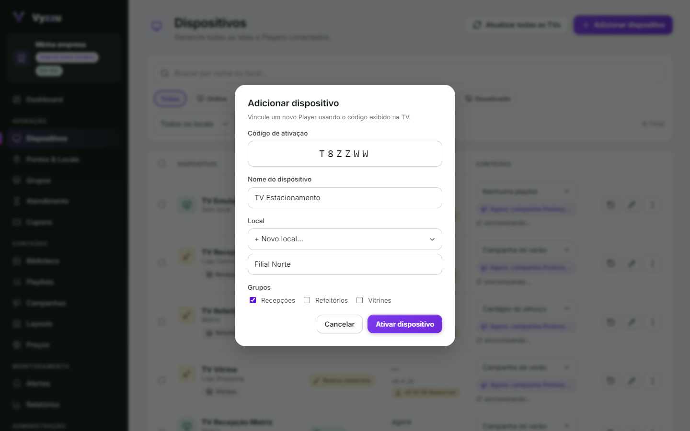

5. Em **Biblioteca**, envie imagens (JPG, PNG, WEBP) e vídeos (MP4).
6. Em **Playlists → Nova playlist**, adicione as mídias, ajuste a duração de cada imagem e clique em **Publicar alterações**.
7. Em **Dispositivos**, na linha da TV, escolha a playlist na coluna **Playlist**.
8. Em até uns **30 a 60 segundos** a TV baixa o conteúdo e começa a exibir.

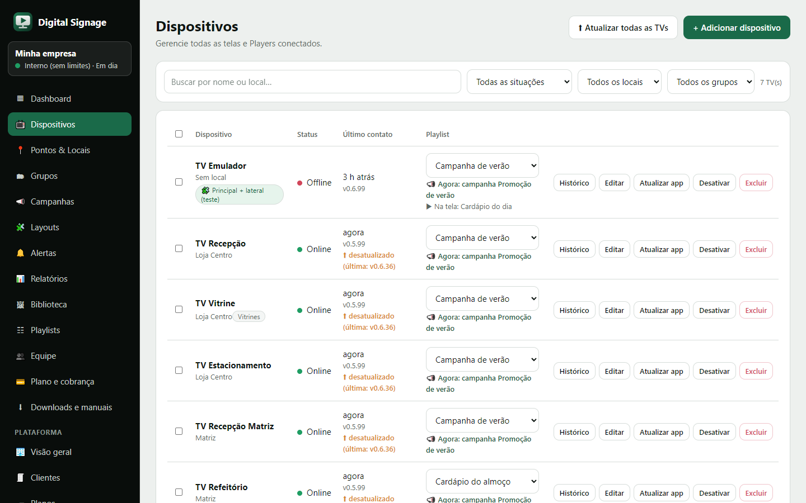


O passo a passo de mídias e playlists, com mais detalhes, está no **Manual do painel**.

> **Na primeira vez do dia, o painel pode demorar até 1 minuto** para responder (o servidor "acorda"). É normal no plano gratuito. **Isso nunca interrompe a TV:** ela continua exibindo o que já baixou.

### 2.5.1 O Smartplay reabre sozinho

O Player foi feito para ficar o dia inteiro na tela e **volta sozinho** nestas situações:

- **Ao ligar a TV** e **depois de uma atualização** do aplicativo (já era assim);
- **Depois de uma queda**: se o app fechar por um erro inesperado, ele reabre em 3 segundos. Se cair várias vezes seguidas, a espera cresce (10 s, 30 s, 1 min, até 5 min) para não ficar num laço; a queda aparece no **Histórico** da TV, no painel;
- **Quando o Android fecha o app** (por falta de memória, por exemplo): um **vigia** confere a cada 2 minutos e reabre se o Player não estiver na tela.

Se **você** sair de propósito (botão **Voltar** ou **Início** do controle), o vigia espera **10 minutos** antes de trazer o Player de volta, o suficiente para entrar nas configurações da TV. Em Android 10 ou mais novo isto depende da permissão "exibir sobre outros apps" (seção 2.3).

### 2.5.2 TVs com pouca memória

Em TVs e pen drives de entrada (cerca de 1 GB de RAM), o Player se adapta sozinho: decodifica as imagens em tamanho menor (até 1280×720), toca **um vídeo por vez** (vídeos em zonas que não são a principal são pulados, com um aviso), solta o decodificador e a página web assim que terminam de ser usados e devolve memória quando o Android pede. Quando um vídeo não pode ser decodificado pelo aparelho (HEVC em modelo antigo, 4K), a TV avisa na tela e no Histórico, e o Player segue para o próximo item.

### 2.6 Deixar a TV pronta para exibir o dia todo

Estas são configurações da própria TV, não do Player:

- **Protetor de tela:** *Configurações → Preferências do dispositivo → Protetor de tela* → **Iniciar agora/Quando iniciar → Nunca**.
- **Desligar sozinha:** *Configurações → Preferências do dispositivo → Energia* → desative o **desligamento por inatividade/temporizador**.
- **Brilho e economia de energia:** desative o "modo eco" ou "economia de energia" se ele reduzir a luz com o tempo.
- **Atualizações do sistema:** deixe como estiver; evite atualizar a TV em horário de expediente.

<a id="27-testar-se-ficou-tudo-certo"></a>

### 2.7 Testar se ficou tudo certo

Faça nesta ordem e marque:

- [ ] A TV exibe as mídias em **tela cheia**, sem barras do sistema.
- [ ] No painel, a TV aparece **Online** em *Dispositivos*.
- [ ] Altere a playlist no painel: a TV atualiza em até 1 minuto.
- [ ] **Sem internet:** desligue o Wi‑Fi do roteador por 2 minutos. A TV deve **continuar exibindo**. Ao religar, volta a ficar Online.
- [ ] **Reinício:** desligue a TV da tomada e ligue de novo. O Player deve **abrir sozinho** e voltar a exibir (precisa da permissão "Exibir sobre outros apps").

---

## 3. Fire TV Stick (Amazon)

> O Fire TV Stick usa o **Fire OS**, baseado em Android. O Player funciona nele, mas o **início automático ao ligar** depende da versão do Fire OS e ainda **não foi medido** num aparelho real (veja a [seção 3.5](#35-abrir-sozinho-ao-ligar)).

### 3.1 Preparar o Fire TV Stick

1. **Configurações → Meu Fire TV → Sobre**. Selecione o nome do aparelho ("Fire TV Stick") e aperte **OK 7 vezes**. Aparece "Você agora é um desenvolvedor".
2. Volte um nível: surgiu **Opções do desenvolvedor**. Entre.
3. Ligue **Depuração ADB** (necessária só para o método B).
4. Ligue **Instalar apps desconhecidos** (em versões antigas chama-se **Apps de fontes desconhecidas**). Nas versões novas, a chave é **por aplicativo** e você a liga no passo 3.2.

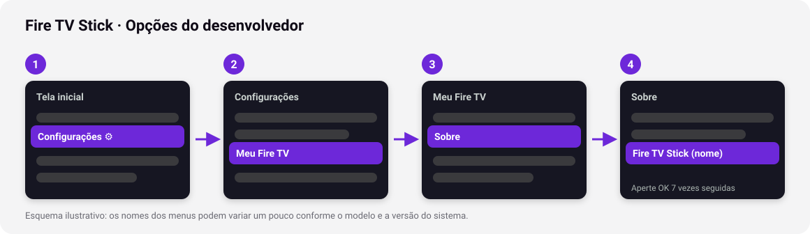

### 3.2 Método A — instalar com o app Downloader (sem computador)

**Passo 1 — Instale o Downloader.**

1. Na tela inicial, escolha **Buscar** (lupa) e digite **Downloader**.
2. Escolha o app laranja do **AFTVnews** e clique em **Baixar/Obter**. Depois **Abrir**.
3. Permita o acesso a arquivos quando pedir.

**Passo 2 — Deixe o Downloader instalar apps.**

*Configurações → Meu Fire TV → Opções do desenvolvedor → Instalar apps desconhecidos* → ligue **Downloader**.

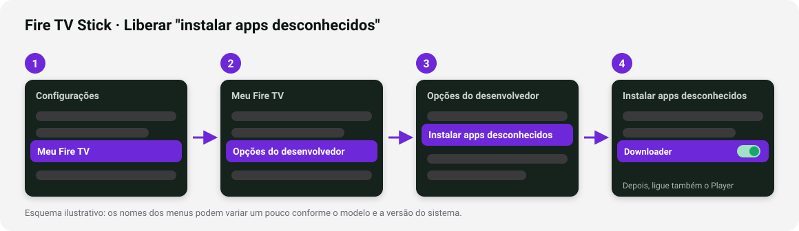

**Passo 3 — Baixe o Player.**

1. Abra o **Downloader**, vá em **Início** e, no campo de URL, digite: `signage-downloads.pages.dev/d`.
2. Escolha **Ir**. O arquivo é baixado.
3. Clique em **Instalar** e, no final, em **Concluído**.
4. Quando o Downloader perguntar sobre o arquivo, escolha **Excluir**.

### 3.3 Onde fica o app depois de instalado

O Fire TV **não coloca** apps de fora da loja na tela inicial. Para abrir:

*Configurações → Aplicativos → Gerenciar aplicativos instalados → Smartplay → Iniciar aplicativo.*

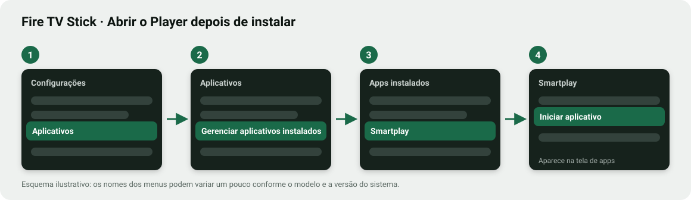

Dica: nessa mesma tela, depois de abrir o app uma vez, ele passa a aparecer no final da lista **Seus aplicativos**. Para movê-lo para o começo, selecione o ícone, aperte o botão **menu (≡)** do controle e escolha **Mover**.

### 3.4 Permissão para atualizar sozinho

Volte em *Configurações → Meu Fire TV → Opções do desenvolvedor → Instalar apps desconhecidos* e ligue também **Smartplay**. Sem isso o Player não consegue se atualizar.

<a id="35-abrir-sozinho-ao-ligar"></a>

### 3.5 Abrir sozinho ao ligar

- O Fire TV **liga com a TV** (via HDMI‑CEC) e o Player tenta abrir sozinho nesse momento.
- Em Fire OS baseados em **Android 9** isso costuma funcionar sem nenhum ajuste.
- Em versões mais novas pode ser preciso liberar **"Exibir sobre outros apps"**. O Fire TV não tem esse menu na tela: use o **método B**:

```powershell
.\adb connect IP_DO_FIRE_TV:5555
.\adb shell appops set com.digitalsignage.player SYSTEM_ALERT_WINDOW allow
```

(O IP fica em *Configurações → Meu Fire TV → Sobre → Rede*.)

> Se, mesmo assim, o Player não abrir sozinho no seu Fire TV Stick, **anote o modelo e a versão do Fire OS** (em *Sobre*) e avise a equipe: dá para tratar por outros caminhos.

### 3.6 Método B — instalar com o computador (ADB)

Idêntico ao da TCL ([seção 2.4](#24-metodo-b-instalar-com-o-computador-adb)). A única diferença é o IP: use o do Fire TV (*Configurações → Meu Fire TV → Sobre → Rede*). O Fire TV também pede para autorizar o computador na primeira vez ("Permitir depuração USB?").

### 3.7 Ativar e testar

Igual à TCL: siga a [seção 2.5](#25-ativar-a-tv-e-exibir-as-propagandas) e a [seção 2.7](#27-testar-se-ficou-tudo-certo).

### 3.8 Cuidados específicos do Fire TV Stick

- O Fire TV Stick tem **pouca memória** (o modelo "Lite" tem 1 GB). Prefira **imagens até Full HD (1920×1080)** e **vídeos MP4 H.264 de até 1080p**.
- Evite vídeos muito pesados (mais de ~50 MB); além de lentos no Stick, o plano gratuito do servidor rejeita arquivos maiores que 50 MB.
- Não deixe o Fire TV em **modo de economia** que desliga a imagem: *Configurações → Preferências → Exibição e sons → Protetor de tela → Iniciar protetor de tela → Nunca*.

---

## 4. Conferir se o arquivo é autêntico (opcional, recomendado)

Na página de downloads, abaixo de cada versão, aparece o **SHA‑256** do arquivo. Para conferir no Windows, depois de baixar:

```powershell
certutil -hashfile player-0.3.0.apk SHA256
```

O resultado precisa ser **idêntico** ao da página. O Android também recusa qualquer atualização que não venha assinada com a mesma chave das versões anteriores, então ninguém consegue trocar o Player por outro aplicativo.

---

## 5. Comandos úteis (ADB)

Todos começam com `.\adb` (troque `IP_DA_TV` pelo endereço da sua TV e rode `.\adb connect IP_DA_TV:5555` antes):

| O que fazer | Comando |
|---|---|
| Ver se a TV está conectada | `.\adb devices` |
| Instalar / atualizar à mão | `.\adb install -r player-0.3.0.apk` |
| Abrir o Player | `.\adb shell am start -n com.digitalsignage.player/.MainActivity` |
| Apontar para outro servidor | `.\adb shell am start -n com.digitalsignage.player/.MainActivity --es server_url https://meu-servidor` |
| Voltar ao estado de fábrica (pede novo código) | `.\adb shell am start -n com.digitalsignage.player/.MainActivity --ez reset true` |
| Desligar a atualização automática | `.\adb shell am start -n com.digitalsignage.player/.MainActivity --ez auto_update false` |
| Só atualizar em um horário (ex.: de madrugada) | `.\adb shell am start -n com.digitalsignage.player/.MainActivity --es update_window "02:00-05:00"` |
| Atualizar a qualquer hora de novo | `.\adb shell am start -n com.digitalsignage.player/.MainActivity --es update_window ""` |
| Ver a versão instalada | `.\adb shell dumpsys package com.digitalsignage.player \| findstr versionName` |
| Desinstalar | `.\adb shell pm uninstall com.digitalsignage.player` |
| Capturar a tela da TV | `.\adb exec-out screencap -p > tv.png` |

---

<a id="6-atualizacao-automatica"></a>

## 6. Atualização automática

**O Player se atualiza sozinho, sem Google Play.** Sempre que uma versão nova é publicada, ela aparece no site de downloads e no painel (menu **Downloads e manuais**); as TVs descobrem e se atualizam.

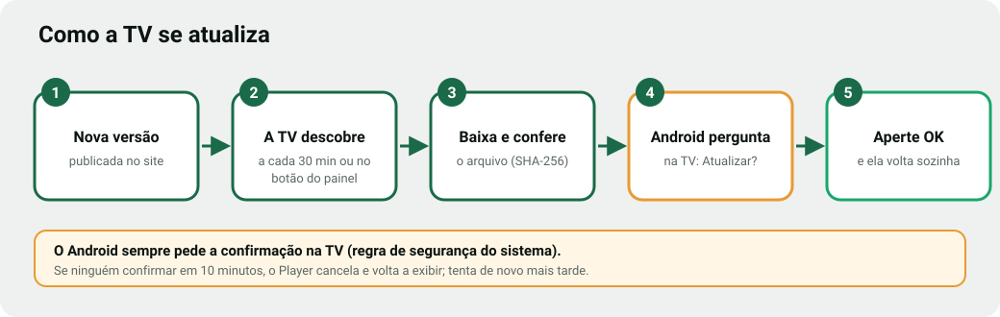

**Como a TV descobre a versão nova**

- Sozinha, **a cada 30 minutos** (e cerca de 1 minuto e meio depois de abrir o Player).
- **Na hora**, quando você pede pelo painel: em **Dispositivos**, clique em **Atualizar app** na linha de uma TV, ou em **Atualizar todas as TVs** no alto da página. A TV recebe o pedido em até 30 segundos.

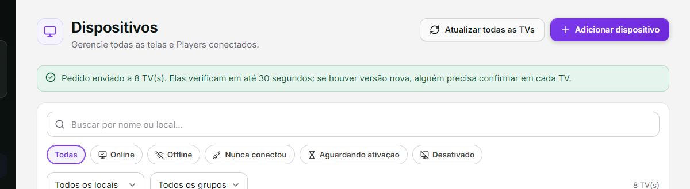

Ela baixa o arquivo, **confere o SHA‑256** e entrega ao instalador do Android. O Player nunca instala um arquivo que não bata com o SHA‑256 publicado, nem uma versão igual ou mais antiga.

**O que você vai ver na TV:** quando a nova versão está pronta, o Android abre uma janela de confirmação sobre a propaganda (em inglês ou português, conforme o idioma da TV): **"Do you want to update this app?"** (*Deseja atualizar este app?*), com os botões **Install/Update** e **Cancel**.

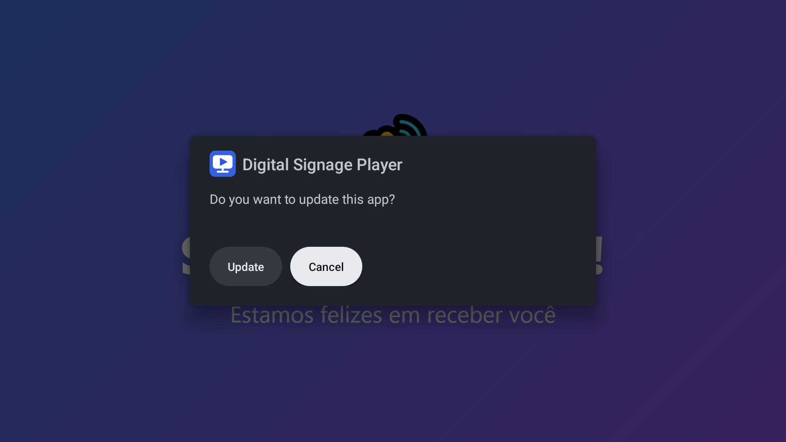

- Aperte **OK** no botão **Instalar/Atualizar**. Se o foco estiver em **Cancelar**, aperte **←** (esquerda) e depois **OK**.
- Em alguns segundos o Player é reinstalado e **volta sozinho para a tela** (precisa da permissão "Exibir sobre outros apps").

**Limitação do Android (medida na prática):** no Android 14 (testado em um emulador de Android TV) o sistema **sempre pede essa confirmação**, mesmo quando o Player já é o instalador do app e mesmo com ele em segundo plano. **Ou seja, alguém precisa apertar OK na TV.** Para evitar propagandas cobertas por tempo indeterminado:

- Se **ninguém confirmar em 10 minutos**, o Player **cancela** a instalação, mostra um aviso por 10 segundos e volta sozinho a exibir. Ele tenta de novo mais tarde.
- Você pode escolher o **horário** das atualizações (`update_window`, seção 5) para que ocorram com alguém presente, ou desligá‑las (`auto_update false`) e atualizar quando quiser, com o método B.
- Atualizações **realmente silenciosas** só existem em aparelhos gerenciados por MDM/"proprietário do dispositivo" ou com acesso root, o que está fora do escopo deste manual.

**Como saber a versão de cada TV:** no painel, em *Dispositivos*, abaixo do "Último contato" aparece a versão (por exemplo `v0.4.7`). TVs com versão anterior à mais recente aparecem marcadas como **⬆ desatualizado**.

**Se a TV não atualiza:** a mensagem de diagnóstico aparece no rodapé da tela de aviso do Player (por exemplo: "falta liberar instalar apps desconhecidos"). Veja também a tabela abaixo.

---

## 7. Solução de problemas

**Avisos de erro.** Quando algo dá errado, o Player mostra uma faixa vermelha no alto da tela com a explicação em português, por **10 segundos**, sem interromper as propagandas. No painel, o aviso fica na tela **até você clicar em Fechar**.

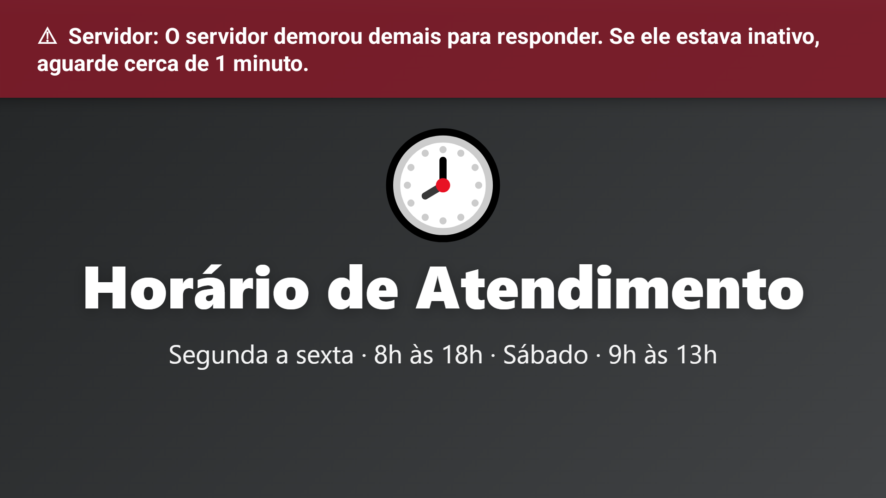

| Problema | O que fazer |
|---|---|
| **"App não instalado"** / **"Conflito com o pacote existente"** | Já existe uma versão assinada com outra chave (por exemplo, uma versão de teste). **Desinstale o Player** (*Configurações → Apps → Smartplay → Desinstalar*) e instale de novo. |
| A TV não deixa instalar | Falta liberar **"Fontes desconhecidas / Instalar apps desconhecidos"** para o Downloader (seção 2.2 passo 2 ou 3.2 passo 2). |
| **"Sem conexão com o servidor"** | Confira a internet da TV. Se o servidor estava "dormindo", espere ~1 minuto: o Player tenta de novo sozinho. Aperte **OK** no controle para conferir/alterar o endereço do servidor. |
| O **código de ativação** não aparece | A tela diz "Iniciando…" ou "Sem conexão": é problema de internet. Aguarde e confira o Wi‑Fi. |
| O código aparece, mas o painel diz "inválido ou expirado" | O código vale por 24 horas e é de uso único. Reinicie o Player (ou use `--ez reset true`) para gerar um novo. |
| A TV mostra **"Aguardando conteúdo"** | Ela está ativa, mas sem playlist. No painel, escolha uma playlist para ela na coluna **Playlist**. |
| Vídeo não toca | Use **MP4 com vídeo H.264**. Outros formatos (MOV, AVI, MKV, HEVC) podem não funcionar. |
| A imagem fica cortada | O Player mostra a imagem inteira (sem cortar). Prefira arquivos **16:9** (1920×1080). |
| A tela **apaga ou aparece o protetor de tela** | Desative o protetor de tela e o desligamento automático da TV (seção 2.6/3.8). |
| O Player **não abre sozinho** ao ligar | Falta a permissão **"Exibir sobre outros apps"** (seção 2.3) ou, no Fire TV, o comando da seção 3.5. |
| **Atualização não aparece** | Falta **"Instalar apps desconhecidos"** para o Player (seção 2.3 / 3.4). Confira também se o horário não está restrito (`update_window`). |
| A TV aparece **Offline** no painel, mas está exibindo | Normal por até ~2 minutos depois de uma queda de internet. Se persistir, verifique o Wi‑Fi. |
| O painel demora ~1 minuto na primeira vez | O servidor gratuito "dorme" sem uso. É só esperar. Não afeta as TVs. |

---

## 8. Desinstalar ou redefinir

- **Redefinir** (a TV volta a pedir um código de ativação): `adb shell am start -n com.digitalsignage.player/.MainActivity --ez reset true`. No painel, apague o dispositivo antigo em *Dispositivos → Excluir*.
- **Desinstalar:** *Configurações → Apps → Smartplay → Desinstalar* (TCL), ou *Gerenciar aplicativos instalados → Smartplay → Desinstalar* (Fire TV).
- Se você **excluir o dispositivo no painel**, a TV esquece o conteúdo e volta sozinha a pedir um novo código.

---

<a id="anexo-compatibilidade"></a>

## Anexo — Compatibilidade: qual versão do aplicativo para qual TV?

**Existe um único arquivo APK e ele serve para todos os aparelhos listados abaixo.** Não há versão "para TCL" e versão "para Fire TV": o mesmo APK roda em qualquer Android TV, Google TV, Fire TV e TV box com Android **5.0 ou mais novo**, em processadores ARM (32 ou 64 bits) ou x86 (o aplicativo não usa código nativo). A instalação e a atualização automática escolhem sempre a versão mais recente.

| Sistema do aparelho | Versão do Android | Compatível? | Observações |
|---|---|---|---|
| Android TV / Google TV (TCL, Sony, Philips, Xiaomi, TV boxes) | 5.0 a 14 | **Sim** | Testado em emulador com Android **5.1** e **14**. Em TVs reais, veja a nota abaixo. |
| Fire TV Stick / Fire TV (Fire OS 5) | 5.1 | **Sim** | Equivale ao Android 5.1 testado em emulador. |
| Fire TV Stick / Fire TV Cube (Fire OS 6, 7 e 8) | 7.1, 9 e 11 | **Sim** | O início automático ao ligar pode exigir "Exibir sobre outros apps" (seção 3.5). |
| Qualquer aparelho com Android anterior ao 5.0 (inclusive Fire OS muito antigo) | 4.x ou menor | **Não** | O Android é antigo demais para o aplicativo. |
| Samsung (Tizen), LG (webOS), Roku e Apple TV | — | **Não** | Não são Android. Para esses seria preciso outro aplicativo. |

**O que foi realmente testado:** o aplicativo foi executado de ponta a ponta (ativação, exibição, atualização) em **emuladores** de Android TV com Android **5.1** e **14**. **Ainda não foi medido em uma TCL ou em um Fire TV Stick reais.** Se algo se comportar diferente no seu aparelho, anote o **modelo** e a **versão do sistema** (em *Sobre*) e avise a equipe.

**Android 5.0 a 7.0 e certificados:** esses sistemas não conhecem a autoridade de certificados usada pelo site de downloads. O Player já inclui essa autoridade por conta própria, então a atualização automática funciona. Já o app **Downloader** usa as regras do próprio aparelho: se ele mostrar um erro de certificado ao abrir o endereço de download, baixe o APK no computador e instale pelo **método B (ADB)**.

**Vídeos:** use MP4 com vídeo H.264 (até 1080p). É o formato que todos os aparelhos acima reproduzem. Veja também os cuidados da seção 3.8 para o Fire TV Stick.

<!-- fim-do-manual -->

## 9. Para quem publica novas versões

**Automático:** todo push na `master` que altere `player/**` (ou os manuais) dispara o fluxo `.github/workflows/publicar-player.yml`, que compila e assina o APK, publica no site de downloads (`latest.json`, lista de versões, manuais em PDF) e, com isso, as TVs se atualizam. O número da versão vem da contagem de commits (`versionCode`) e do arquivo `player/VERSION`. Veja `docs/DEPLOY.md`, seção "Publicar o Player".

**Manual** (no seu computador): a chave de assinatura fica em `C:\Users\<usuário>\.signage` (**guarde um backup dela**: sem a mesma chave, as TVs não aceitam atualização).

```powershell
node scripts/release-player.mjs --notes "O que mudou nesta versão"   # compila, assina e publica
node scripts/release-player.mjs --site-only                          # só republica manuais/site, sem nova versão
```
