# Manual do painel

Como usar o **painel de administração** do Vyzzu no dia a dia: enviar imagens e vídeos, montar playlists, vincular TVs e acompanhar se está tudo funcionando.

> **Endereço do painel:** `https://signage-painel.pages.dev`. Funciona em computador, tablet e celular. O aplicativo da TV e os manuais ficam sempre atualizados em **Downloads e manuais** (menu à esquerda).

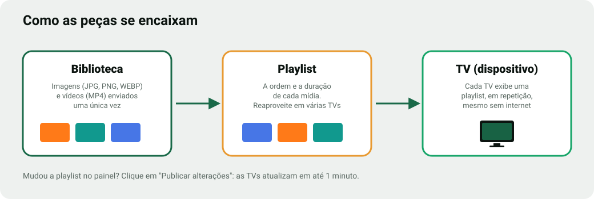

**Em resumo, o trabalho é sempre o mesmo:**

1. Enviar as mídias para a **Biblioteca** (uma vez só).
2. Montar uma **Playlist** com as mídias na ordem e com o tempo que você quiser.
3. Em **Dispositivos**, escolher qual playlist cada TV exibe. Com várias TVs, organize-as em **Locais** (onde estão) e **Grupos** (conjuntos para agir juntos) e aplique a playlist a todas de uma vez. Para conteúdo que só vale em certas datas, dias ou horários, use **Campanhas**.
4. Acompanhar: o **Dashboard**, os **Alertas** (o painel avisa quando uma TV some) e os **Relatórios** (disponibilidade, exibições, inventário).
5. Para telas mais elaboradas, dividir a tela em zonas com **Layouts** e usar **QR Codes** e **páginas da web**.
6. Dar acesso à equipe com o **papel** certo para cada pessoa (**Equipe**) e acompanhar o **Plano e cobrança**. Quem opera o serviço para vários clientes usa a área **Plataforma**.

---

## 1. Entrar no painel

1. Abra o endereço do painel no navegador.
2. Digite o **seu e-mail** e a **sua senha** e clique em **Entrar**. Cada pessoa tem o próprio acesso (veja o capítulo 11).

**Esqueceu a senha?** Clique em **Esqueci a senha** (abaixo do campo da senha), digite o e-mail da sua conta e abra o link que chegar na sua caixa de entrada (olhe o spam na primeira vez). O link vale **1 hora** e **só funciona uma vez**: nele você escolhe a senha nova (mínimo de 8 caracteres) e depois entra normalmente. Por segurança, a tela responde a mesma coisa exista ou não uma conta com aquele e-mail. Se o e-mail nunca chega, o envio de e-mail pode ainda não estar ativado no servidor: peça ao Administrador do seu cliente para definir uma senha nova em **Equipe** (veja 11.2).

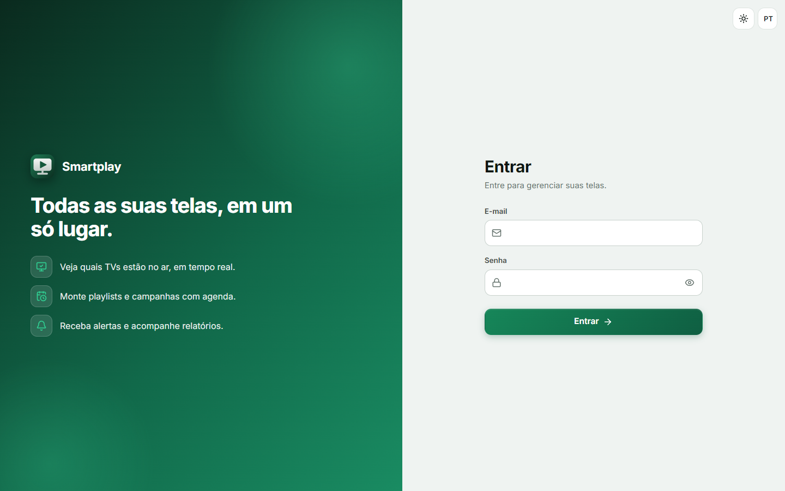

> **Na primeira vez do dia, o painel pode demorar até 1 minuto** para responder. O servidor gratuito "dorme" quando fica sem uso e leva um tempo para acordar. É normal, e **não afeta as TVs**: elas continuam exibindo o que já baixaram. Quando isso acontece, o painel mostra um **alerta amarelo "O servidor está acordando"** na parte de baixo da tela (já na tela de entrada) e o tira sozinho, com um aviso "Servidor pronto", assim que o servidor responde. Se passar de uns 3 minutos sem resposta, o alerta vira vermelho ("O servidor não respondeu") com o botão **Tentar de novo**: confira a sua internet.

Para sair, clique no seu **nome** (a bolinha com as iniciais, no pé do menu à esquerda; no celular, no canto do alto) e escolha **Sair**. No mesmo menu ficam **Minha conta** (troca de senha), o **tema** e o **idioma**. O tema (claro/escuro) e o idioma (português/inglês) também podem ser trocados nos botões do alto da tela de entrada (veja 2.2 e 2.3).

---

## 2. Conhecendo o painel

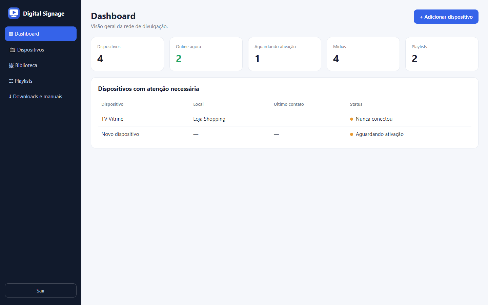

O **menu à esquerda** leva a cada área:

| Menu | Para que serve |
|---|---|
| **Dashboard** | Visão geral: quantas TVs estão online, offline, nunca conectaram ou aguardam ativação; quantas há em cada local; e quais precisam de atenção. Mostra também quantas campanhas valem agora. Clique em qualquer número para ver essas TVs. |
| **Dispositivos** | As TVs: ativar, dar nome, local e grupos, escolher a playlist, filtrar, agir em várias de uma vez, desativar, excluir e pedir atualização do aplicativo. |
| **Pontos & Locais** | Onde estão as TVs (ex.: "Loja Centro"). |
| **Grupos** | Conjuntos de TVs (ex.: "Recepções") para escolher a playlist e atualizar o aplicativo de todas de uma vez. |
| **Campanhas** | Uma playlist com **agenda** (datas, dias da semana, horários), **prioridade** e **alvos** (todas as TVs, locais, grupos ou TVs). |
| **Layouts** | Divide a tela da TV em zonas (conteúdo principal + faixa lateral, rodapé…), cada uma com a sua lista de mídias. Vem com modelos prontos. |
| **Alertas** | O que precisa de atenção agora (TV sem contato, TV que nunca conectou, erros repetidos) e as configurações para receber os avisos no Slack, Discord e similares. |
| **Relatórios** | Disponibilidade das TVs, exibições por mídia, inventário e eventos, com download em CSV para o Excel. |
| **Biblioteca** | Suas imagens e vídeos. |
| **Playlists** | A ordem e o tempo de cada mídia. |
| **Equipe** | *(Administrador)* As pessoas que acessam o painel e o papel de cada uma. |
| **Plano e cobrança** | *(Administrador)* O plano, o uso dos limites, as faturas e como pagar. |
| **Downloads e manuais** | O aplicativo da TV (sempre a versão mais recente) e estes manuais em PDF. |
| **Plataforma** | *(Gestor da plataforma)* Clientes, planos, faturas, gestores e configurações do serviço. |

No alto do menu aparece o **cliente** em que você está, o **plano** e a **situação** da assinatura. O menu é dividido por assunto: **Operação** (TVs, locais, grupos), **Conteúdo** (biblioteca, playlists, campanhas, layouts), **Monitoramento** (alertas e relatórios) e **Administração**. O painel mostra **só o que o seu papel pode usar** (capítulo 11).

Na primeira tela, o **círculo** mostra a **saúde da rede** (quantas TVs ativas estão online) e os selos abaixo dele levam direto à lista de TVs de cada situação. Ao lado de **Alertas**, um **número vermelho** avisa quantos alertas estão abertos, sem você precisar abrir a tela. No topo, enquanto faltar algum, aparece o cartão **Primeiros passos** com as quatro etapas para colocar a primeira tela no ar (**ativar a TV, enviar as mídias, montar uma playlist e escolher o que a TV exibe**): as feitas ganham um visto, a próxima vem destacada e cada etapa tem um botão que leva direto à tela certa. Quando as quatro estão feitas o cartão some sozinho. Só quem pode montar conteúdo (Editor ou Administrador) vê o cartão.

**Os ícones.** Cada informação tem um desenho e uma palavra: o estado de uma TV, por exemplo, é sempre um **selo** com ícone e texto (**Online**, **Offline**, **Nunca conectou**…), nunca só uma cor. As ações que ocupam pouco ficam à vista (**Editar**, **Histórico**) e as demais (**Desativar**, **Atualizar app**, **Excluir**…) ficam no botão de três pontinhos (**⋮ Mais ações**) de cada linha, com **Excluir** sempre separado e em vermelho.

### 2.1 Usar no celular

O painel foi pensado para o **celular**: abra o mesmo endereço no navegador do aparelho (Chrome, Safari…). A tela se reorganiza sozinha:

- No alto fica a **barra** com o botão ☰ (abre o menu completo), o nome do sistema e a **bolinha com as suas iniciais**, que abre o menu da pessoa (**tema**, **idioma**, **Minha conta** e **Sair**).
- Na base ficam **atalhos** para as áreas mais usadas (**Dashboard**, **Dispositivos**, **Alertas**, com um ponto vermelho quando há alerta aberto, e **Biblioteca**) e o botão **Menu**, que abre a lista completa por cima da tela.
- As **tabelas viram cartões**: cada TV, campanha ou fatura ocupa um cartão, com o rótulo de cada informação ao lado do valor. Os botões de cada item ficam no pé do cartão (**Editar** e o menu **⋮**).
- As **janelas** (adicionar TV, editar campanha…) sobem de baixo, como uma folha, e os campos e botões têm tamanho confortável para o dedo.

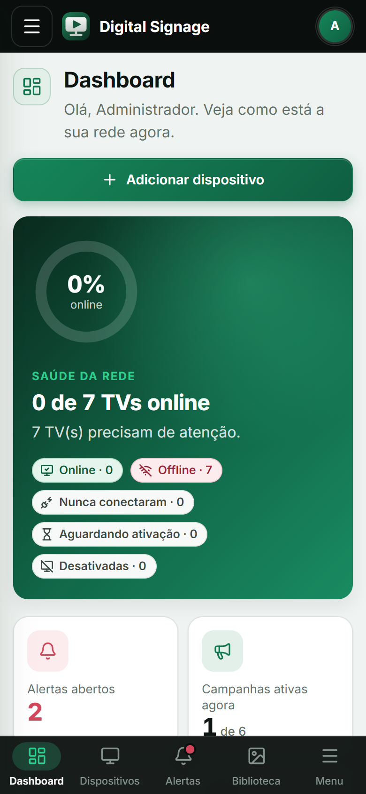

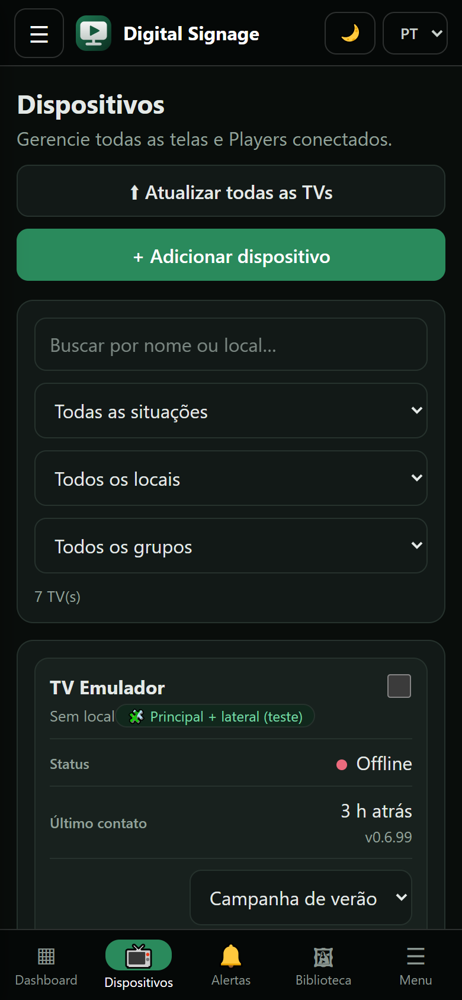

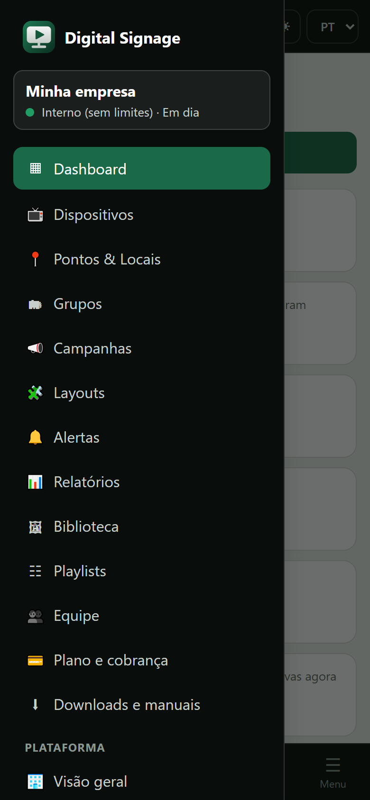

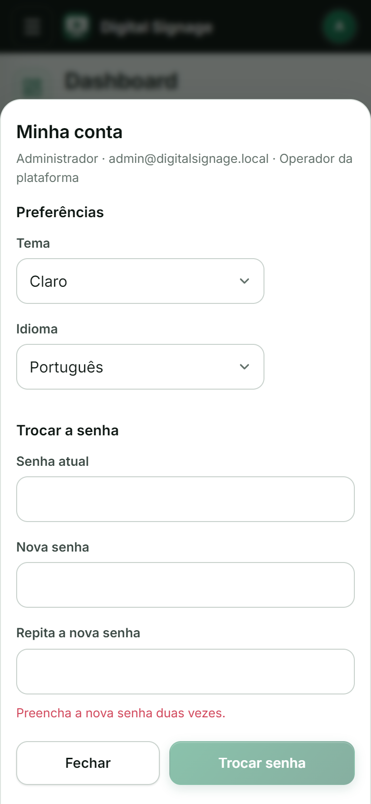

> **Dica:** para abrir o painel com um toque, crie um atalho na tela inicial pelo menu do navegador (**Adicionar à tela inicial**).

### 2.2 Tema claro e escuro

O painel tem um **tema claro** e um **tema escuro**, ambos em preto, violeta e prata. A escolha fica no **menu da pessoa** (clique no seu nome no pé do menu à esquerda; no celular, na bolinha do alto) e também no botão do canto da tela de entrada. As opções:

| Opção | O que faz |
|---|---|
| **Automático** (ícone de monitor) | Segue o aparelho: escuro à noite ou quando o celular/computador está no modo escuro. É a opção inicial. |
| **Claro** (ícone de sol) | Sempre o tema claro. |
| **Escuro** (ícone de lua) | Sempre o tema escuro (descansa a vista em ambientes escuros e economiza bateria em telas OLED). |

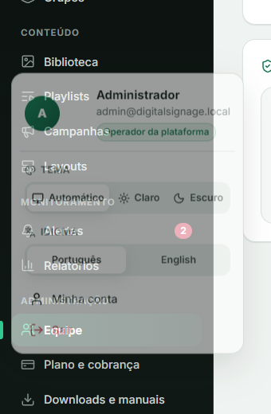

A escolha fica **guardada no aparelho** em que você a fez.

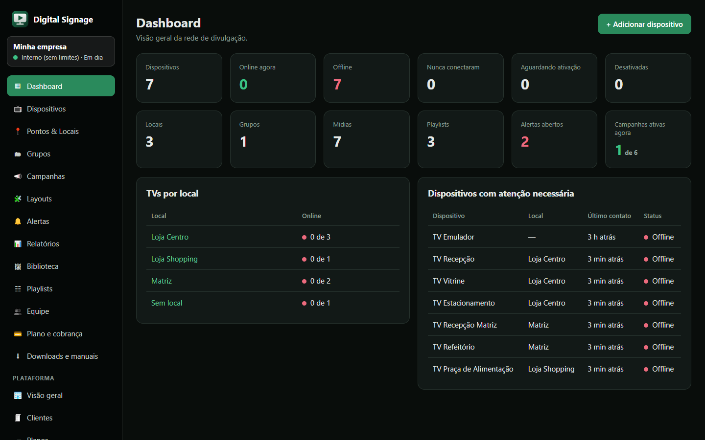

### 2.3 Idioma: português ou inglês

O seletor de **idioma** (no menu da pessoa e no canto da tela de entrada) troca o idioma **na hora**, sem recarregar a página. O **português** é o idioma original e o padrão; o **inglês** traduz os menus, botões, avisos, mensagens de erro, o histórico das TVs e os alertas. A escolha também fica guardada no aparelho.

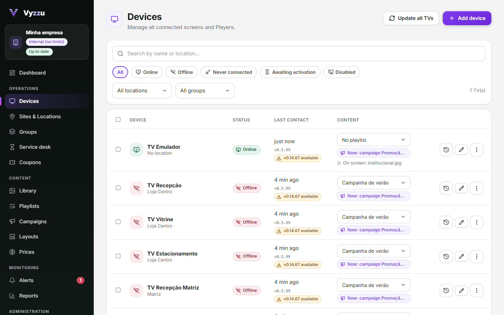

O que **você** digitou (nomes de TVs, playlists, locais, campanhas…) nunca é traduzido, e datas e valores seguem o idioma (por exemplo, `20/10/2026` e `R$ 49,00` em português; `10/20/2026` e `R$49.00` em inglês). Os **manuais em PDF** e os **CSV** dos relatórios continuam em português por enquanto.

---

## 3. Biblioteca: enviar imagens e vídeos

1. Abra **Biblioteca**.
2. Clique em **Enviar mídia** e escolha um ou vários arquivos.
3. Acompanhe a barra de progresso. Ao terminar, a mídia aparece na lista com uma miniatura.

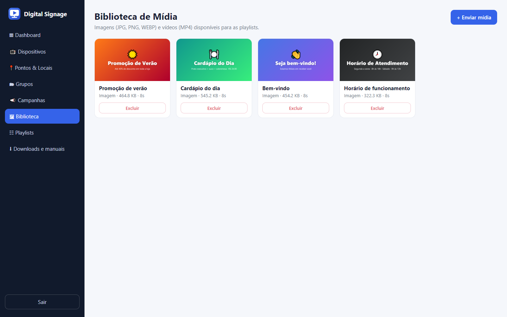

**Formatos aceitos**

| Tipo | Formatos | Recomendação |
|---|---|---|
| Imagem | JPG, PNG, WEBP | Proporção **16:9**, de preferência **1920×1080**. Imagens fora dessa proporção aparecem inteiras, com faixas pretas. |
| Vídeo | **MP4** e **MOV** (o que o **iPhone** grava), em H.264 ou HEVC | O painel **converte para MP4 Full HD (H.264)** ao enviar, quando precisa (veja abaixo). O arquivo que fica na biblioteca tem até **1080p** (1920×1080, deitado ou em pé) e **no máximo 50 MB** (limite do armazenamento gratuito). Outros formatos (AVI, MKV, WEBM) não são aceitos. |

**Vídeos do iPhone: a conversão é automática.** Pode enviar o arquivo direto da galeria, em **.MOV**. O vídeo do iPhone costuma ser pesado (4K, 60 quadros, HEVC, HDR): passa do limite de 50 MB em poucos segundos e muitas TVs e caixas não o tocam bem. Por isso, **antes de enviar**, o próprio painel o converte, **neste aparelho** (o servidor gratuito não aguentaria), para **MP4 em H.264, no máximo Full HD**, com qualidade boa para TV:

- **O que dispara a conversão:** arquivo **.MOV**, vídeo em **HEVC ou outro formato que não seja H.264**, **acima de 1080p**, com **HDR** ou **acima de 50 MB**. Um MP4 em H.264 até 1080p e dentro do limite **não é mexido** (converter de novo só perderia qualidade).
- **O que muda no vídeo:** passa a **MP4 (H.264)**, cabe em **1920×1080** (ou 1080×1920 se foi gravado em pé; nunca é ampliado), vai a **no máximo 30 quadros por segundo** e **até 8 Mbps**. Para caber em 50 MB, vídeos mais longos usam uma taxa menor (um vídeo de 1 minuto fica por volta de 5 Mbps). O **som** é mantido, e o HDR é convertido para as cores normais.
- **Como acompanhar:** o painel mostra **Convertendo para MP4 Full HD** com a porcentagem, e depois **Enviando**. **Mantenha a página aberta**: a conversão roda no navegador e pode levar de segundos a alguns minutos, conforme o tamanho do vídeo e o aparelho (no iPhone e no Mac costuma ser rápido: usam o chip de vídeo). Ao terminar, um aviso diz o tamanho antes e depois. O arquivo vira **nome.mp4** na biblioteca.
- **Quando não dá para converter:** é preciso um navegador atual (**Safari** ou **Chrome/Edge** recentes; o **Firefox** costuma não conseguir). Se o navegador não consegue abrir o vídeo (por exemplo HEVC no Chrome do Windows sem o suporte instalado), o painel avisa e **envia o original**, desde que ele tenha até 1080p e 50 MB; senão explica o que fazer (**enviar pelo celular** costuma resolver). Um vídeo tão longo que não cabe em 50 MB nem convertido (mais de uns 2 minutos em Full HD) é recusado: divida-o em partes.
- **Dica:** se o vídeo ficou sem som depois de convertido, o navegador não conseguiu regravar o áudio; o painel avisa.

A duração do vídeo é preenchida sozinha a partir do próprio arquivo.

Além de arquivos, a Biblioteca também guarda **widgets** (botão **Widget**, seção 3.1), **QR Codes** (botão **QR Code**) e **páginas da web** (botão **Página web**): veja o capítulo 10.

**Excluir uma mídia:** clique nos três pontinhos (**⋮**) do cartão da mídia e em **Excluir**. Se ela estiver em alguma playlist, o painel avisa que não dá para remover; tire-a das playlists primeiro.

### 3.1 Widgets: relógio, clima, notícias, cotações, recado e contagem regressiva

Um **widget** é um conteúdo que **se atualiza sozinho**, sem você enviar arquivo nenhum. Na Biblioteca, clique em **Widget**, escolha o tipo e ajuste. Ao lado, **Como fica na TV** mostra o widget exatamente como a TV vai desenhá-lo (com os dados de agora), em tela horizontal ou **em pé**. Depois é só colocá-lo numa playlist como qualquer mídia: ele conta no tempo da playlist, entra em campanhas, em zonas de layout e na **Comprovação** (seção 9.4).

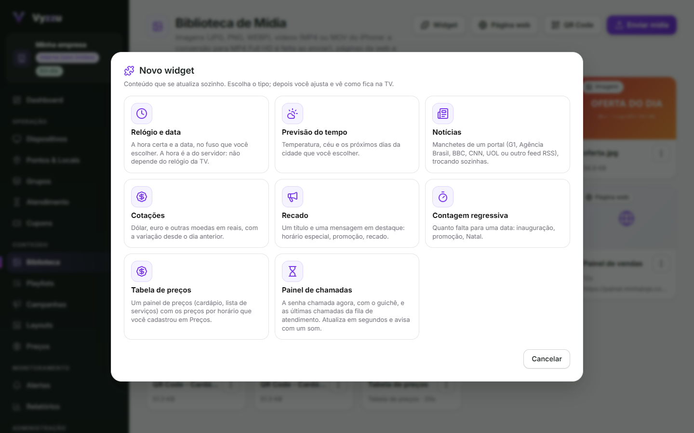

| Tipo | O que mostra | Escolhas |
|---|---|---|
| **Relógio e data** | A hora e a data. A hora vem do **servidor**: mesmo se o relógio da TV estiver errado, o widget está certo. | Fuso horário (Brasília, Manaus, Cuiabá…), texto acima da hora, data, segundos, 12 ou 24 horas. |
| **Previsão do tempo** | Temperatura, céu, umidade, vento e os próximos dias. | **Cidade** (digite e escolha na lista; vale qualquer cidade do mundo), quantos dias. |
| **Notícias** | Manchetes que trocam sozinhas, com a fonte e "há quanto tempo", e as próximas na fila. | Fonte (G1, Agência Brasil, BBC News Brasil, CNN Brasil, UOL ou **outro feed RSS** público em https), quantas manchetes (3 a 12) e segundos por manchete. |
| **Cotações** | Dólar, euro e outras moedas em reais, com a variação desde o dia útil anterior. | Até 4 moedas entre USD, EUR, GBP, JPY, CAD, AUD, CHF, CNY e MXN. |
| **Recado** | Um título e uma mensagem em destaque (horário especial, promoção, aviso). | Título, mensagem, cor de destaque e alinhamento. |
| **Contagem regressiva** | Dias, horas, minutos e segundos que faltam para uma data, e uma frase quando ela chega. | Nome (ex.: Natal), data e hora, fuso e a frase final. |

Em todos: **Cores** (veja abaixo), **idioma** do texto do widget e **tempo na tela**.

**Cores do widget.** Escolha um **tema pronto** (Escuro, Claro, Violeta ou Verde) e, se quiser, personalize por cima dele em **Cores personalizadas**: **Fundo**, **Texto** e **Destaque**. Cada campo tem o seletor de cor e o código `#RRGGBB` (por exemplo `#8B5CF6`); deixe em branco para usar a cor do tema e clique em **Voltar às cores do tema** para limpar tudo. A pré-visualização muda na hora. Se as cores ficarem parecidas demais, o painel avisa ("Contraste baixo…") porque, de longe, na TV, o texto fica difícil de ler; o aviso não impede de salvar. Sem escolher a cor do texto, o widget usa texto claro em fundo escuro e texto escuro em fundo claro. As cores personalizadas valem para todos os tipos de widget (relógio, clima, notícias, cotações, recado, contagem, preços e chamadas). Exigem a **versão mais recente do Player** nas TVs (use **Atualizar app** em **Dispositivos**); um Player mais antigo mostra o tema pronto, sem as suas cores.

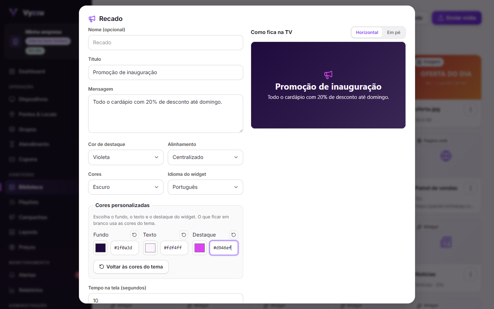

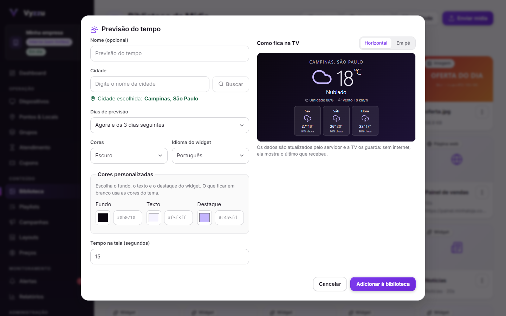

**Como os dados chegam à TV.** Clima, notícias e cotações vêm de serviços públicos gratuitos que **o servidor** consulta (MET Norway para o clima, os feeds RSS dos portais e o Banco Central Europeu via Frankfurter). A TV nunca fala com eles: pede ao servidor, a cada 10 minutos, e **guarda o último dado**. Resultado:

- **Sem internet, o widget continua na tela** com o último clima, as últimas manchetes e as últimas cotações recebidos (se estiverem velhos, aparece "atualizado há…" discreto no rodapé). Relógio, recado e contagem regressiva nem precisam de dados.
- Cidades com a mesma localização compartilham a mesma consulta; o servidor guarda o clima por 30 minutos, as notícias por 15 e as cotações por 1 hora. Se o serviço de fora falhar, vale o último resultado por até 24 horas.
- As **cotações** são a referência diária do Banco Central Europeu (dias úteis), não o preço de agora de uma casa de câmbio: bom para informar, não para operar.
- **Notícias:** só as manchetes são exibidas, sempre com o nome da fonte. Respeite os termos de uso do feed que escolher.

**Editar:** pelos três pontinhos do cartão do widget, **Editar**. As TVs recebem a mudança no próximo contato (o tipo não muda: para outro tipo, crie outro widget).

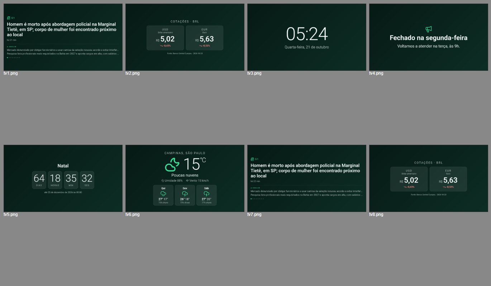

Há ainda o widget **Tabela de preços**, que exibe uma tabela da página **Preços** (seção 3.2).

**Requisito:** Vyzzu 0.11 ou mais novo na TV (o painel de preços pede o 0.12). Uma TV com Player mais antigo não sabe desenhar widgets: mostra um aviso na tela por alguns segundos, registra no Histórico e passa para o próximo item.

### 3.2 Preços dinâmicos: tabelas de preços e preços por horário

Para cardápios, listas de serviços e preços do dia, use a página **Preços** (menu **Conteúdo**). Uma **tabela de preços** é a lista dos seus produtos ou serviços com o preço de cada um; o widget **Tabela de preços** (Biblioteca > **Widget**) a desenha na TV. **Mudou um preço? Salve na página Preços e as TVs que mostram a tabela atualizam sozinhas, em cerca de um minuto**, sem refazer nenhuma imagem.

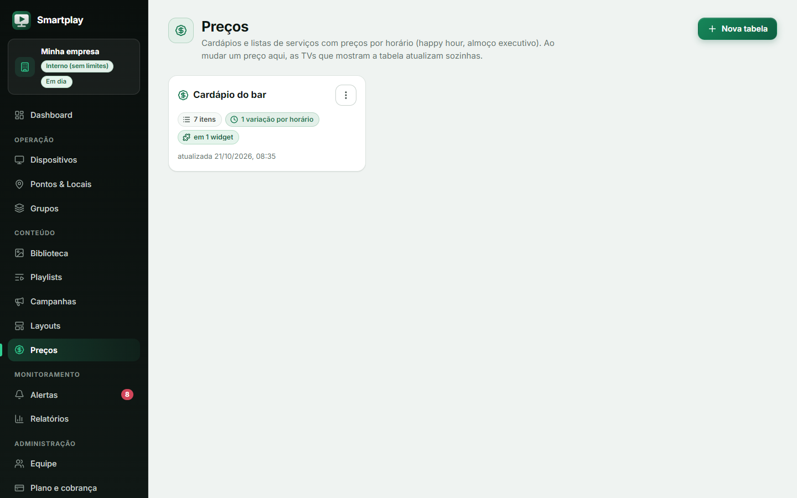

**Montar a tabela.** Em **Preços > Nova tabela**: dê um nome, escolha a moeda (real, dólar ou euro) e o fuso dos horários. Em **Itens**, preencha a categoria (cabeçalho que agrupa os itens), o nome, uma descrição curta (opcional), o **preço** e a unidade (un, kg, porção). Marque **Disponível** (desmarcado, o item aparece riscado e com "Esgotado", sem preço) e **Destaque** (um ponto de destaque ao lado do nome). As setas reordenam; a lixeira remove. Até 300 itens por tabela.

**Planilha (CSV).** Já tem os preços no Excel? Salve a planilha como **CSV** e use **Importar planilha** (troca todos os itens) ou **Acrescentar da planilha** (junta aos que já existem). A primeira linha precisa dos títulos **Nome** e **Preço**; podem vir também **Categoria**, **Descrição**, **Unidade**, **Disponível** (sim/não) e **Destaque**. Aceita ponto e vírgula ou vírgula, preço como `12,50`, `12.50` ou `R$ 1.234,56`, e arquivos do Excel em português. Linhas sem nome ou com preço ilegível são ignoradas, e o painel lista quais foram. **Baixar planilha** gera o CSV da tabela para editar fora e importar de volta. (A importação exige a tabela já salva.)

**Preços por horário.** Em **Preços por horário** crie variações como:

- **Happy hour:** todos os dias, 17:00 às 20:00, **-20%** só na cerveja e na caipirinha;
- **Almoço executivo:** segunda a sexta, 11:00 às 15:00, **preço fixo** no prato do dia;
- **Madrugada:** sexta, 22:00 às 02:00, +15% (um fim antes do início passa da meia-noite; o dia da semana vale pelo dia em que a janela **começa**).

Cada variação tem dias da semana (vazio = todos), horário (vazio = o dia todo) e **o que muda**: um **percentual** (negativo é desconto, positivo é acréscimo; em todos os itens ou só em alguns) ou **preços fixos por item**. Quando duas variações valem ao mesmo tempo para o mesmo item, **vale a primeira da lista** (use as setas). Na TV, o preço de base aparece riscado ao lado do novo preço, que ganha cor, e uma etiqueta mostra a variação em vigor ("HAPPY HOUR").

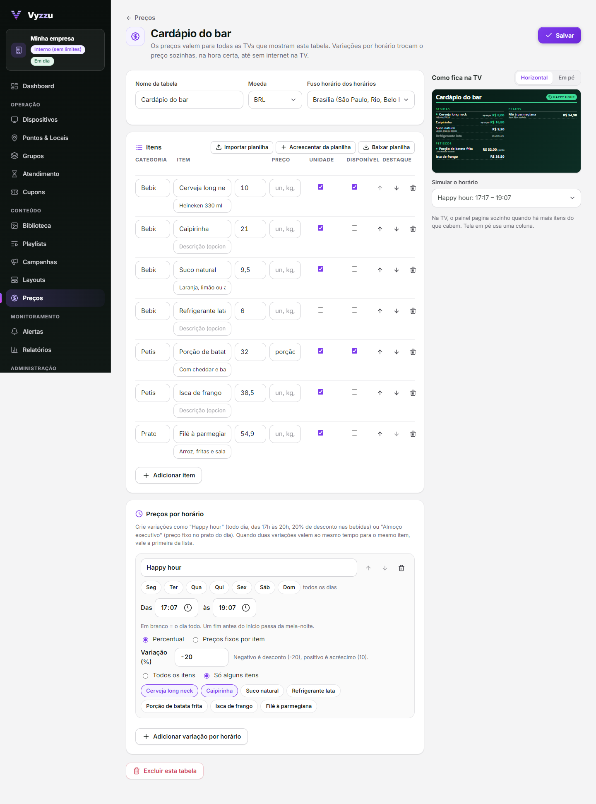

**Ver antes de publicar.** À direita, **Como fica na TV** mostra o painel, na tela horizontal ou **em pé**, e **Simular o horário** deixa escolher qualquer intervalo das próximas 24 horas ("como fica no happy hour?"). O painel é calculado pelo servidor com as mesmas regras que as TVs usam.

**Na TV.** O widget troca o preço **no minuto certo, até sem internet**: a TV guarda os preços das próximas 24 horas, em intervalos, e só olha o relógio (que é o do servidor, mesmo se o da TV estiver errado). Se a lista for maior do que cabe na tela, o painel **pagina sozinho** (use um tempo na tela longo o bastante para todas as páginas: o ponto de cada página aparece embaixo). Em **tela em pé** o painel usa uma coluna e mostra mais linhas.

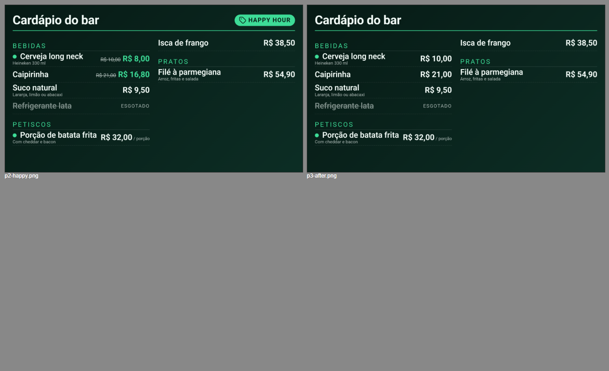

**Excluir.** Uma tabela usada por um widget da Biblioteca não pode ser excluída: o painel avisa quantos widgets a usam. Exclua ou troque esses widgets primeiro.

---

## 4. Playlists: montar o que vai passar na TV

### 4.1 Criar uma playlist

1. Abra **Playlists** e clique em **Nova playlist**.
2. Dê um **nome** (ex.: "Campanha de verão") e, se quiser, uma descrição.
3. Na coluna **Biblioteca** (à direita), **clique nas mídias** para adicioná-las à sequência.
4. Ajuste cada item:
   - **Duração (s):** quantos segundos a imagem fica na tela. Para vídeos vale a duração do próprio vídeo.
   - **Setas para cima e para baixo:** mudam a posição na sequência.
   - **Lixeira:** tira o item da playlist (a mídia continua na Biblioteca).
5. Confira o **ciclo total** ("ciclo de 32s") e clique em **Publicar alterações**.

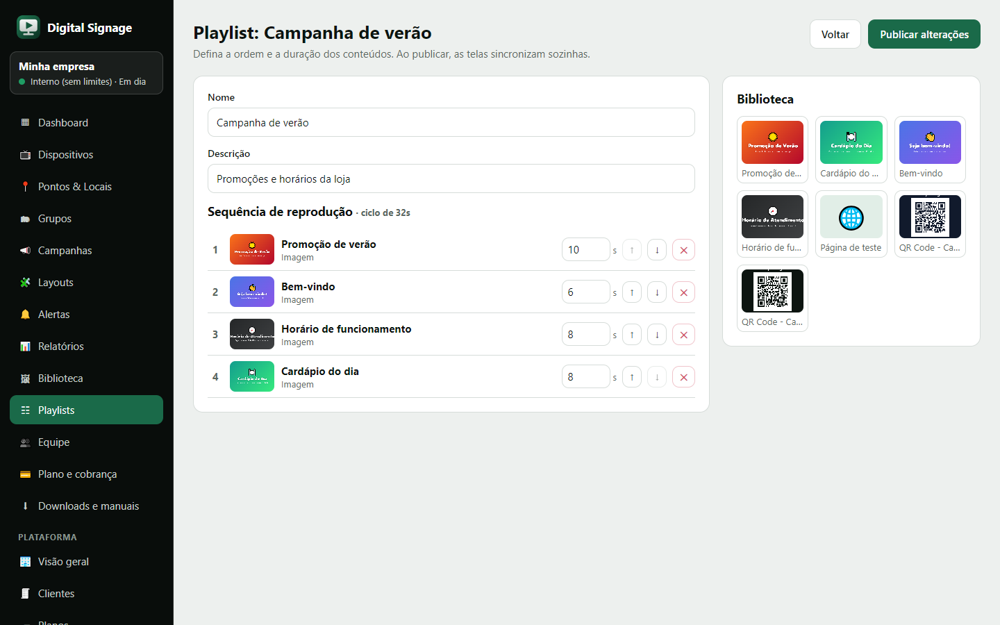

> **Importante:** as mudanças só valem para as TVs depois de **Publicar alterações**. Em até 1 minuto elas baixam a novidade e passam a exibi-la.

### 4.2 Lista de playlists

Em **Playlists** você vê todas, com o número de itens, a duração do ciclo e a **versão** (sobe a cada publicação). Use **Editar** para alterar e, no menu **⋮**, **Excluir** para apagar. Se você excluir uma playlist que está em uso, as TVs que a usavam ficam **sem playlist**.

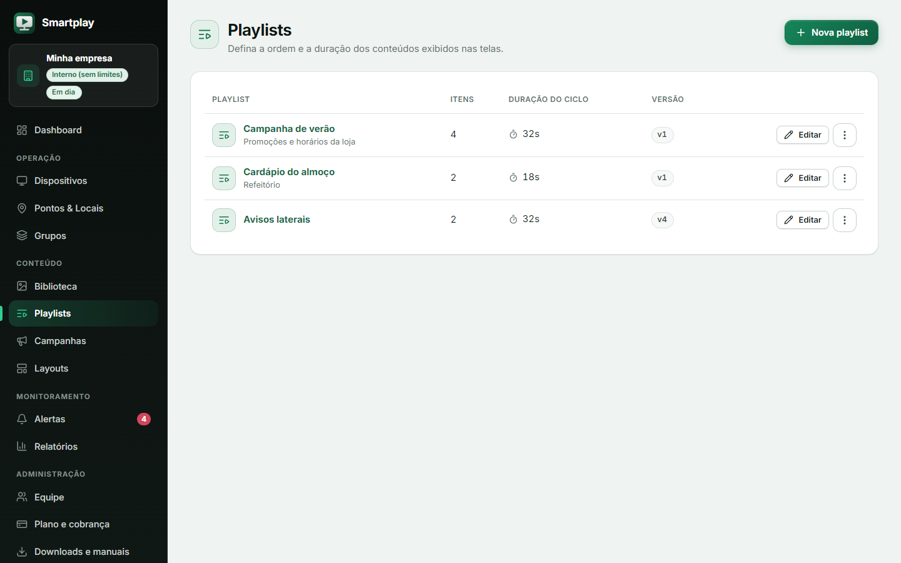

---

## 5. Dispositivos: as TVs

### 5.1 Ativar uma TV nova

**Pelo QR Code (o jeito mais rápido, sem digitar):**

1. Instale o Player na TV (veja o **Manual de instalação**). Ao abrir, ela mostra um **QR Code** e, ao lado, o **código de 6 letras e números**.
2. Com o celular, aponte a câmera para o QR Code e abra o endereço. Entre no painel, se pedir (você volta direto à tela de pareamento).
3. Se você é da equipe da plataforma, escolha o **cliente** da TV.
4. Escolha o **local** (o nome da TV já vem sugerido, por exemplo "Loja Centro - TV 2") e toque em **Ativar TV**. Menos de um minuto, sem digitar nada.

Só o **Administrador** do cliente pode parear TVs. Se o QR Code mostrar "Código inválido ou expirado", a TV gerou um código novo: escaneie o QR Code que está na tela agora.

**Pelo código (alternativa, no computador):**

1. A TV mostra o **código de 6 letras e números**.
2. No painel, abra **Dispositivos** e clique em **Adicionar dispositivo**.
3. Digite o **código** e dê um **nome** (ex.: "TV Recepção").
4. Escolha o **Local** na lista. Se ainda não existe, escolha **+ Novo local…** na lista e digite o nome (ele é criado na hora). Se a TV não tem local, deixe **Sem local**.
5. Marque os **Grupos** de que a TV faz parte (opcional) e clique em **Ativar dispositivo**.

O código vale por **24 horas** e só pode ser usado uma vez. Se expirar, reinicie o Player na TV para gerar outro.

### 5.2 Escolher a playlist de cada TV

Na linha da TV, use a lista da coluna **Playlist**:

- escolha uma playlist para a TV começar a exibi-la (em até 1 minuto);
- escolha **Nenhuma playlist** para tirar o conteúdo: a TV passa a mostrar "Aguardando conteúdo". A playlist em si **não** é apagada.

A playlist escolhida aqui é a **playlist da TV**: o que ela exibe quando nenhuma campanha vale. Quando uma campanha está valendo, aparece abaixo da lista o aviso **"Agora: campanha …"** (a campanha tem prioridade sobre a playlist da TV).

### 5.3 O que significa cada status

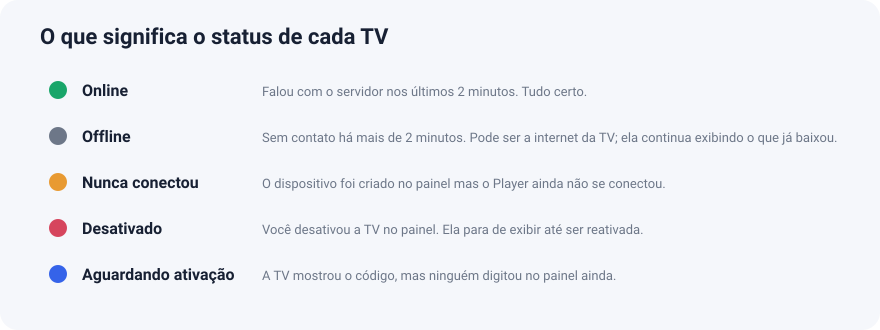

### 5.4 Buscar e filtrar

Acima da lista ficam a busca e três filtros. Todos funcionam juntos:

- **Buscar:** digite parte do nome da TV ou do local.
- **Situação:** Online, Offline, Nunca conectou, Aguardando ativação ou Desativado.
- **Local** (inclui "Sem local") e **Grupo**.

O contador à direita mostra quantas TVs aparecem. **Limpar filtros** volta à lista completa. Os números do Dashboard, a lista de Locais e a lista de Grupos também levam para esta página já filtrada.

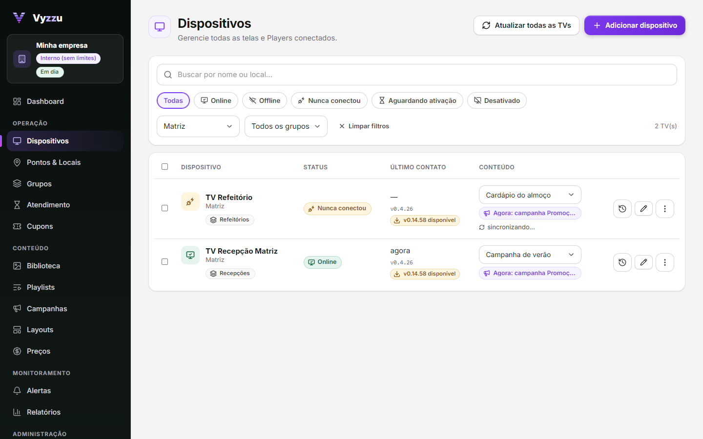

### 5.5 Agir em várias TVs de uma vez

1. Marque as TVs na primeira coluna (ou a caixa do cabeçalho para marcar **todas as da lista**, respeitando os filtros).
2. Aparece a barra violeta **"N selecionadas"** com as ações:

| Ação | O que faz |
|---|---|
| **Escolher playlist…** | Aplica a playlist escolhida a todas as selecionadas (ou **Nenhuma playlist** para tirar). |
| **Desativar / Reativar** | Pausa ou volta a ativar as TVs. Desativar pede confirmação. TVs que ainda aguardam ativação não são afetadas. |
| **Atualizar app** | Pede que as TVs verifiquem agora se há versão nova do aplicativo. |
| **Mover para local…** | Muda o local de todas as selecionadas (ou **Sem local**). |
| **Adicionar ao grupo… / Tirar do grupo…** | Coloca as TVs num grupo ou as retira dele. |

O painel confirma quantas TVs foram alcançadas. Se uma ação não se aplica a algumas (por exemplo, reativar uma TV que já está ativa), ele avisa quantas ficaram de fora.

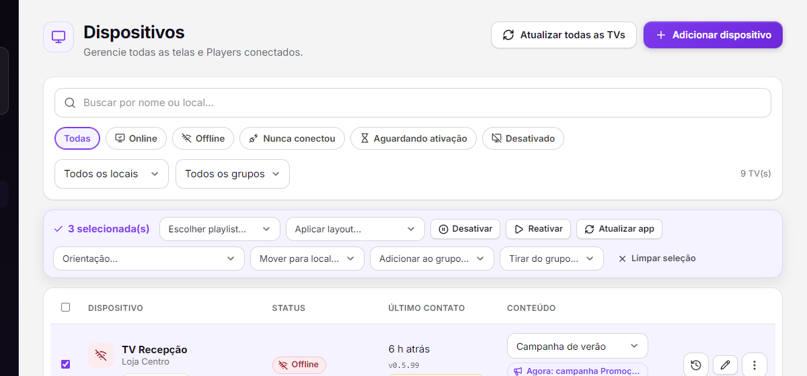

### 5.6 Outras ações de cada TV

Cada linha tem o ícone de **relógio com seta** (Histórico), o **lápis** (Editar) e o menu **⋮ Mais ações**. Em telas mais estreitas o botão Editar mostra só o lápis.

| Botão | O que faz |
|---|---|
| **Histórico** | Abre a linha do tempo da TV: quando conectou, caiu, mudou de conteúdo, atualizou e o que o Player relatou (veja 9.1). |
| **Editar** | Muda o nome, o local, os grupos, o layout da tela e **como a TV foi instalada** (horizontal ou vertical, veja 5.6.3). |
| **Atualizar app** (menu **⋮**) | Pede que **esta TV** verifique agora se há versão nova do aplicativo (ela percebe em até 30 segundos). |
| **Atualizar todas as TVs** (no alto da página) | O mesmo pedido para todas as TVs ativas. |
| **Desativar / Reativar** (menu **⋮**) | Pausa a TV (ela para de exibir) ou volta a ativá-la. |
| **Excluir** (menu **⋮**) | Remove a TV. Ela esquece o conteúdo e volta a pedir um **novo código de ativação**. |

### 5.6.3 TV instalada na vertical (orientação da tela)

Uma TV presa na parede **em pé** continua recebendo da caixa de TV um vídeo **deitado** (a maioria das caixas não gira sozinha). Por isso você diz ao Vyzzu como a TV está instalada, e o **Player gira o conteúdo** para ele ficar de pé para quem olha.

1. Em **Dispositivos**, clique em **Editar** na TV (é preciso ser **Administrador**).
2. Em **Como a TV foi instalada**, escolha:
   - **Automática** (padrão): nada é girado. É a opção das TVs deitadas.
   - **Horizontal**: a TV está deitada, na posição normal.
   - **Vertical, topo da TV para a direita** ou **para a esquerda**: a TV está em pé. O **topo da TV** é o lado do botão de ligar ou da logomarca; conte para que lado ele aponta, **de frente para a TV**. O desenho ao lado da lista mostra a TV girada e a palavra "Aa" de pé: se ficou como a sua TV, está certo.
   - **Horizontal, de cabeça para baixo**: TV deitada, mas invertida (instalada no teto, por exemplo).
3. **Salvar.** Em até 1 minuto a TV gira o conteúdo. Se a escolha ficou de cabeça para baixo, é só trocar entre as duas opções verticais.

Para várias TVs de uma vez, marque-as e use **Orientação…** na barra violeta (só Administrador).

- Em TV **vertical**, o **layout** usa a **versão em pé** (veja 10.1.1); sem versão em pé, o layout horizontal é girado junto, como está.
- As TVs verticais mostram um selo **Vertical** (ou **De cabeça para baixo**) na lista, e o **Histórico** registra a mudança.
- **Vídeo:** numa TV girada o vídeo passa a ser desenhado de outro jeito (mais exigente para o aparelho). Em caixas muito simples, teste um vídeo pesado antes de instalar.
- Use só a opção do Vyzzu: **não** gire a tela nas configurações do Android da caixa. O Player é travado na horizontal e não foi testado com a tela do Android girada.

### 5.6.1 O que acontece na TV quando você troca a playlist

A TV **não apaga a playlist antiga antes** de baixar a nova: ela baixa **todas** as mídias que faltam, confere cada arquivo e **só então** troca. Enquanto isso continua exibindo o conteúdo anterior, e uma falha de internet no meio do download não derruba a tela. Depois da troca, as mídias que nenhuma playlist da TV usa mais são **apagadas** do aparelho, para não encher a memória. Mídias que as duas playlists têm em comum não são baixadas de novo.

Como a troca é "tudo ou nada", por um instante a TV guarda as duas versões: se o armazenamento dela for pequeno e o conteúdo novo não couber, a TV **mantém o anterior** e registra o motivo no **Histórico** ("Não há espaço na TV para baixar o conteúdo novo…"). Nesse caso apague mídias grandes que não usa mais ou use arquivos menores.

### 5.6.2 Sem internet: o que a TV faz (modo offline inteligente)

A internet de uma loja cai, e a propaganda **não pode parar nem ficar errada**. Por isso a TV leva consigo, além do que está no ar, a **agenda dos próximos 7 dias**:

- **Campanhas por horário continuam certas.** O servidor calcula, para cada TV, o que deve estar no ar em cada intervalo (campanha vencedora pela prioridade, alvo, dias e horários, inclusive janelas que passam da meia-noite) e entrega esse resultado à TV. Sem internet, a TV só olha o relógio e troca no minuto certo: a campanha das 18h entra às 18h e sai às 23h mesmo com o roteador desligado.
- **As mídias já estão na TV.** Logo depois de baixar o que está no ar, a TV baixa também as mídias das campanhas que vão ao ar nos próximos dias (a mais próxima primeiro). Isso usa espaço: se não couber tudo, a TV guarda o que couber, **nunca atrapalha o conteúdo atual** e avisa no **Histórico** ("Sem espaço para guardar toda a agenda offline…").
- **A hora é a do servidor.** A cada contato a TV anota a hora real do servidor e conta o tempo a partir daí, então um relógio de TV errado (acontece muito) não troca campanha na hora errada. Se a TV for desligada e ligada sem internet, ela abre já no intervalo certo.
- **Quem manda é o servidor quando há internet.** A TV só segue a agenda guardada depois de **cerca de 75 segundos sem resposta** do servidor. Quando a conexão volta, ela confere com o servidor: se ele concorda, a tela nem pisca; se você mudou algo enquanto isso (pausou uma campanha, trocou a playlist), vale o que o servidor diz.
- **A agenda se renova sozinha** enquanto há internet (uma vez a cada dois dias, e na hora em que você cria, edita ou pausa uma campanha). No **Histórico da TV** o selo **agenda offline até …** mostra até quando a TV está coberta. Sem selo: a TV não tem campanhas, ou usa um Player anterior ao 0.10.
- **Tudo fica registrado.** O Histórico mostra "Sem contato com o servidor: a TV segue a agenda guardada", qual campanha entrou no ar e "Contato com o servidor restabelecido". As exibições feitas sem internet entram na **Comprovação** (seção 9.4) assim que a conexão volta, com a numeração e a corrente de hashes intactas.

**O que não dá para fazer sem internet:** conteúdo novo (uma mídia que nunca chegou à TV) e mudanças feitas no painel só chegam quando a conexão volta. Passados os 7 dias da agenda, a TV continua exibindo o último conteúdo que tinha, sem ficar em branco.

### 5.7 Atualizar o aplicativo das TVs

Quando existe uma versão nova do Player, as TVs descobrem sozinhas em até 30 minutos. Para adiantar, use **Atualizar app** (uma TV), **Atualizar todas as TVs**, ou a ação em massa. O painel avisa que o pedido foi enviado:

> **O Android sempre pede uma confirmação na TV** antes de instalar a atualização (regra de segurança do sistema). Alguém precisa apertar **OK** no controle. Se ninguém confirmar em 10 minutos, a TV cancela e volta a exibir normalmente. Detalhes no **Manual de instalação**, seção "Atualização automática".

TVs com versão mais antiga que a última publicada aparecem com o selo **vX.Y.Z disponível** (ícone de download) na coluna "Último contato".

### 5.8 Alertar agora: aviso em tela cheia

Para avisar na hora quem está olhando para a TV (fechamos mais cedo, chame o gerente, evacuação), abra **Alertar agora** no menu (Administrador e Editor):

1. Escreva a **mensagem** (até 300 caracteres) e, se quiser, um **título** curto (aparece em letras maiúsculas, como "ATENÇÃO").
2. Escolha a **urgência**, que define a cor da tela: **Urgente** (vermelho), **Atenção** (âmbar) ou **Informativo** (violeta). O quadro "Assim aparece na TV" mostra o resultado antes de enviar.
3. Escolha **para quem**: **Todas as TVs**, **Um grupo** ou **Uma TV**. A linha de cima do botão diz quantas TVs vão receber.
4. Escolha **por quanto tempo** fica na tela: 5, 15 (padrão), 30 minutos, 1 ou 4 horas, ou **Até eu encerrar** (que vale no máximo 24 horas: nenhum aviso fica na TV para sempre).
5. Clique em **Alertar agora**. Um clique só.

O aviso cobre **toda a tela**, por cima da playlist, dos vídeos e dos widgets, e o som dos vídeos fica desligado enquanto ele estiver no ar. A TV percebe o aviso na próxima conferência com o servidor, **em até 30 segundos**. Ele sai **sozinho no fim do prazo** (mesmo se a internet da TV cair no meio) ou quando você clica em **Encerrar agora** em **No ar agora** (também em até 30 segundos).

- Em **No ar agora** aparecem os avisos ativos, para quem foram, quantas TVs devem mostrá-los, quanto falta e quem mandou. **Avisos anteriores** guarda o histórico (encerrados e vencidos).
- Pode haver até **5 avisos no ar** ao mesmo tempo. Se uma TV deve mostrar mais de um, aparece o **mais urgente** (entre iguais, o mais novo); ao encerrar esse, o outro volta.
- O Visualizador consegue ver a tela, mas não enviar nem encerrar avisos.
- **Precisa do Player novo na TV** (a partir da versão que traz esta função). Uma TV com Player antigo ignora o aviso e continua na playlist; o aviso fica registrado no histórico da TV quando ela o mostra.
- Uma TV **sem internet** não recebe o aviso novo nem o encerramento: ela só segue o que já estava na tela.

---

## 6. Pontos & Locais

Um **local** é um ponto físico onde há TVs (ex.: "Loja Centro", "Matriz"). Cada TV pertence a **um** local (ou a nenhum). Usar locais permite ver, por local, quantas TVs estão online e filtrar a lista.

1. Abra **Pontos & Locais**.
2. Clique em **Novo local**, digite o **nome** (e, se quiser, uma descrição como o endereço) e salve.
3. Na lista você vê quantas TVs há em cada local e quantas estão online. Clique no número de TVs para abrir **Dispositivos** já filtrado por esse local.

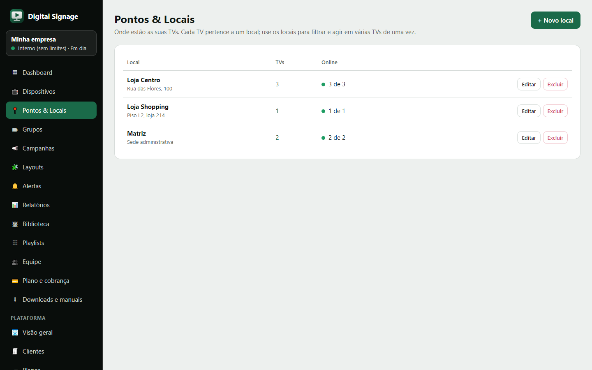

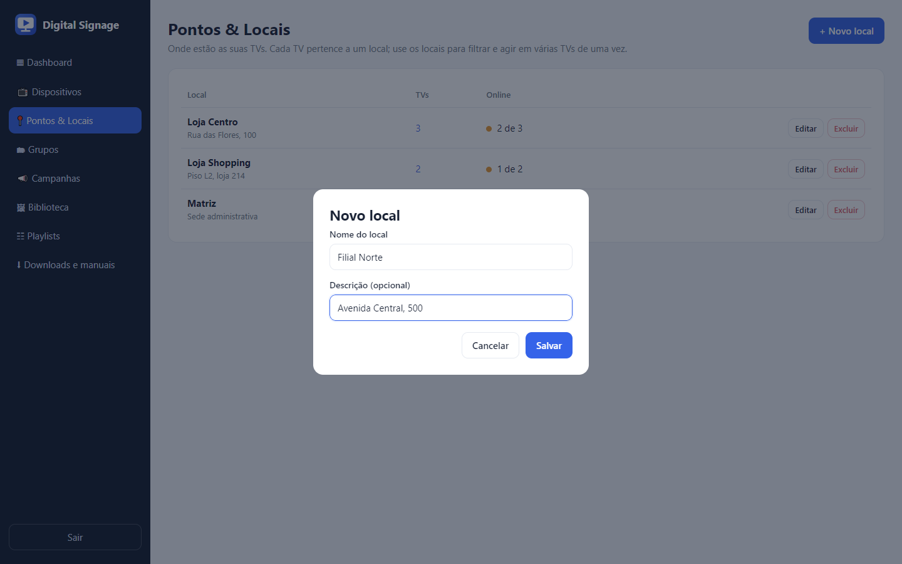

- **Editar** muda o nome e a descrição. Dois locais não podem ter o mesmo nome (maiúsculas e minúsculas contam como iguais).
- **Excluir** (no menu **⋮**) apaga só o local. **As TVs continuam funcionando** e ficam "Sem local".
- Para colocar TVs num local: escolha o local ao ativar a TV, edite a TV, ou use a ação **Mover para local…** em várias TVs.

---

## 7. Grupos

Um **grupo** é um conjunto livre de TVs (ex.: "Recepções", "Vitrines", "Refeitórios"). Uma TV pode estar em vários grupos. Grupos servem para **agir em várias TVs de uma vez**, mesmo de locais diferentes.

1. Abra **Grupos** e clique em **Novo grupo**.
2. Dê um nome (e, se quiser, uma descrição) e **marque as TVs** do grupo. Salve.
3. Na lista de grupos você pode, para todas as TVs do grupo:
   - **Escolher uma playlist** (ou **Nenhuma playlist**) na coluna "Playlist para todas as TVs do grupo". O painel pede confirmação antes de aplicar.
   - **Atualizar app** (no menu **⋮**): pede que verifiquem se há versão nova do aplicativo.

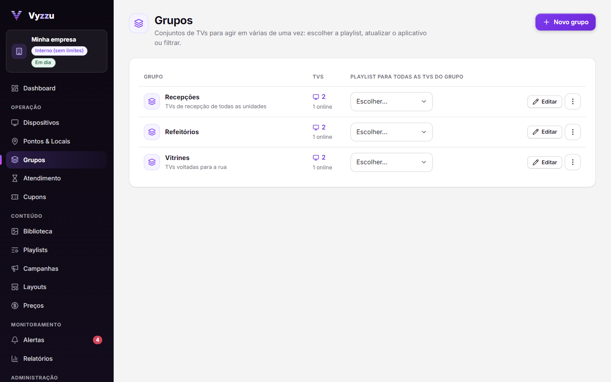

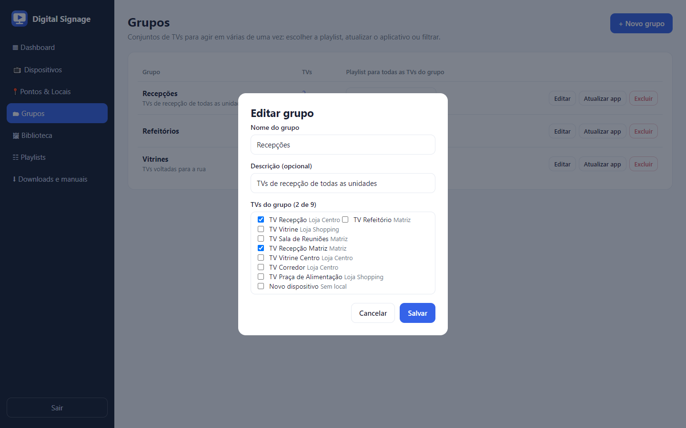

- **Editar** muda o nome, a descrição e quem faz parte.
- **Excluir** (no menu **⋮**) apaga só o grupo. **As TVs não são apagadas**: apenas deixam de fazer parte dele.
- O número de TVs do grupo abre **Dispositivos** filtrado por esse grupo.

---

## 8. Campanhas

Uma **campanha** é uma playlist com agenda: ela só vale em certas **datas**, **dias da semana** e **horários**, para as TVs que você escolher, e tem uma **prioridade**. Exemplos: o cardápio do almoço das 11h às 14h nos refeitórios; uma promoção de 1 a 30 de novembro em todas as lojas; um aviso só no fim de semana.

Sem campanhas, cada TV exibe a playlist dela, como sempre. Quando uma campanha vale, ela **substitui** a playlist da TV enquanto durar, e a TV volta sozinha ao conteúdo normal depois.

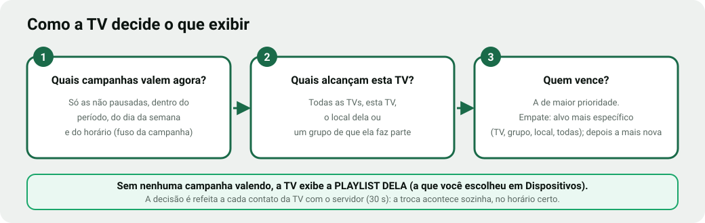

### 8.1 Criar uma campanha

1. Abra **Campanhas** e clique em **Nova campanha**.
2. Dê um **nome**, escolha a **playlist** que será exibida e a **prioridade** (veja 8.3).
3. Em **Quando**, defina:
   - **De / Até (data):** o período (as duas datas valem). Deixe vazio para não limitar.
   - **Dias da semana:** marque os dias em que vale.
   - **O dia todo** ou um **horário** (das … às …). Se o fim for antes do início (por exemplo, das 22:00 às 06:00), a campanha atravessa a meia-noite e conta pelo dia em que **começa**: "sexta das 22h às 6h" vale de sexta 22h até sábado 6h.
   - **Fuso horário:** as datas e horas valem neste fuso (o padrão é o de Brasília).
4. Em **Para quem**, marque **Todas as TVs** ou escolha **locais**, **grupos** e **TVs** (pode misturar: a campanha vale para a soma deles).
5. Salve. As TVs alcançadas passam a seguir a campanha **sozinhas, no horário dela**: não é preciso fazer mais nada.

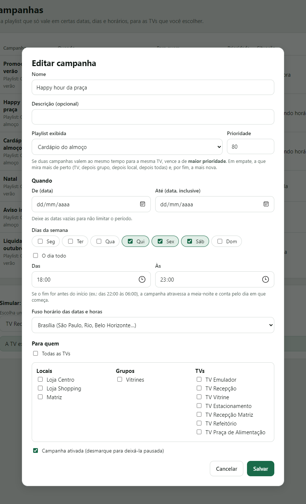

### 8.2 A lista de campanhas

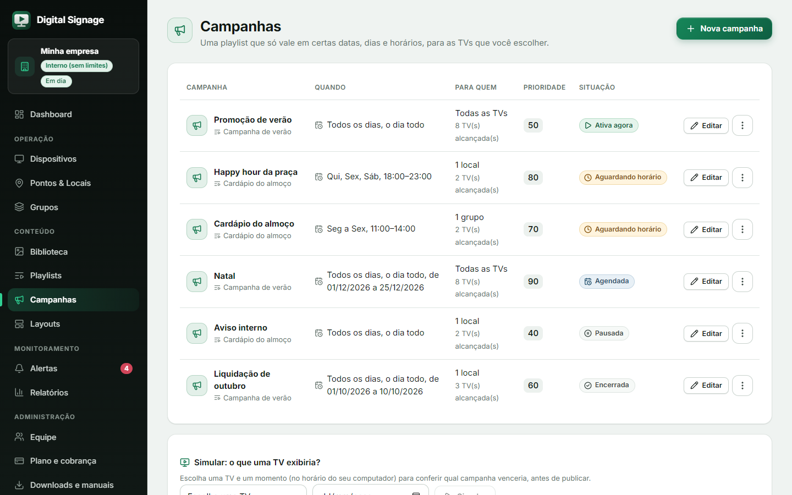

| Situação | O que significa |
|---|---|
| **Ativa agora** | Está valendo neste momento nas TVs que ela alcança. |
| **Aguardando horário** | Está no período, mas hoje ainda não é o dia ou a hora dela. |
| **Agendada** | O período ainda não começou. |
| **Encerrada** | O período já terminou. |
| **Pausada** | Você a pausou; não é exibida até **Reativar**. |

Use **Pausar/Reativar** (no menu **⋮**) para desligar uma campanha sem apagá-la, **Editar** para mudar qualquer coisa e **Excluir** (também no **⋮**) para remover (as TVs voltam à playlist delas ou a outra campanha que valha). Uma **playlist em uso por uma campanha** não pode ser excluída: o painel diz qual campanha a usa.

### 8.3 Prioridade: quando duas campanhas valem ao mesmo tempo

Se mais de uma campanha vale agora para a mesma TV, vence a de **maior prioridade** (0 a 1000; o padrão é 50). Em caso de empate, vence a que mira **mais de perto** (TV, depois grupo, depois local, depois "todas as TVs") e, se ainda empatar, a mais nova.

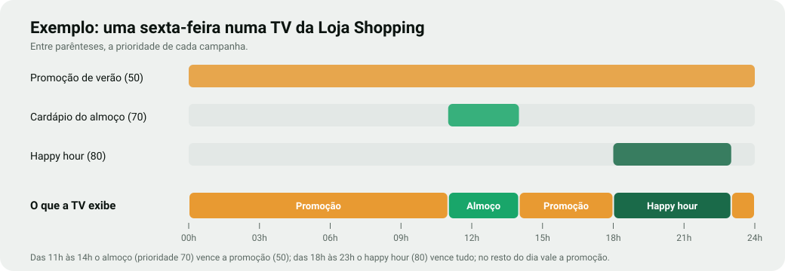

### 8.4 Simular antes de publicar

No fim da página há o **Simulador**: escolha uma TV e um dia/hora (no horário do seu computador) e clique em **Simular**. O painel diz qual playlist a TV exibiria e de qual campanha, ou se vale a playlist da própria TV. Ótimo para conferir uma agenda nova.

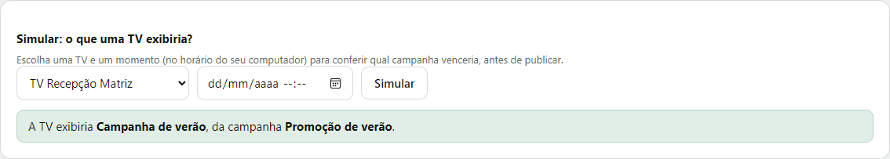

> **A TV precisa estar online para trocar.** Ela descobre a mudança no contato com o servidor (a cada 30 segundos) e baixa a playlist da campanha. Se a TV estiver sem internet na hora da troca, continua exibindo o que já tinha e troca quando a conexão voltar. Para campanhas importantes, **deixe a TV online um pouco antes** do horário, para ela já ter baixado o conteúdo.

---

## 9. Monitoramento: alertas, histórico e relatórios

O painel não mostra só a situação de agora: ele **guarda a história de cada TV**, **avisa quando algo dá errado** e gera **relatórios** do que aconteceu. Nada disso exige configurar algo na TV; basta o Player estar na versão **0.5 ou mais nova** para também contar erros, a mídia na tela e as exibições (as TVs com versão mais antiga continuam aparecendo, só sem esses dados — o **Atualizar app** resolve).

### 9.1 Histórico de uma TV

Em **Dispositivos**, clique em **Histórico** na linha da TV. Você vê, do mais recente para o mais antigo, tudo o que aconteceu com ela:

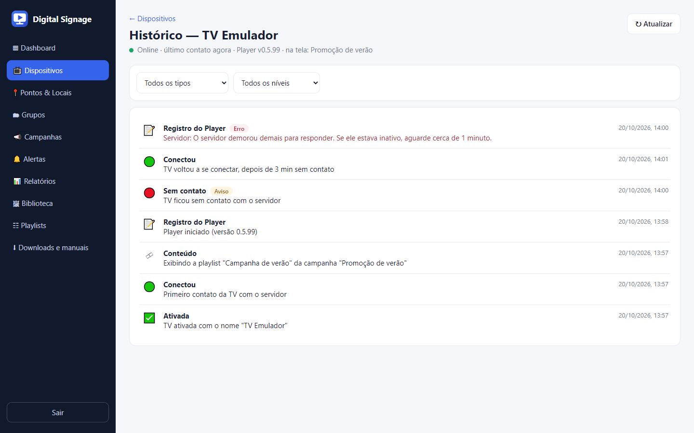

| Evento | Quando aparece |
|---|---|
| **Ativada** | Você digitou o código da TV no painel. |
| **Conectou** | Primeiro contato, ou a TV **voltou** depois de ficar sem contato (diz por quanto tempo). |
| **Sem contato** | A TV parou de falar com o servidor. A hora é a da queda (2 minutos depois do último contato), não a hora em que o painel percebeu. |
| **Conteúdo** | A TV passou a exibir outra playlist ou campanha (diz qual). |
| **Desativada / Reativada** | Você pausou ou reativou a TV no painel. Enquanto está desativada, a TV não conta como queda. |
| **Atualização pedida** / **Player atualizado** | Você pediu a atualização do aplicativo; a TV passou de uma versão para outra. |
| **Registro do Player** | Algo que a **própria TV** relatou: um erro (mídia que não abre, download que falhou, aplicativo reiniciado depois de uma falha), um aviso ou "Player iniciado". |

Use os filtros de **tipo** e **nível** (só erros, só avisos…) e **Carregar mais** para ir ao passado. A página se atualiza sozinha.

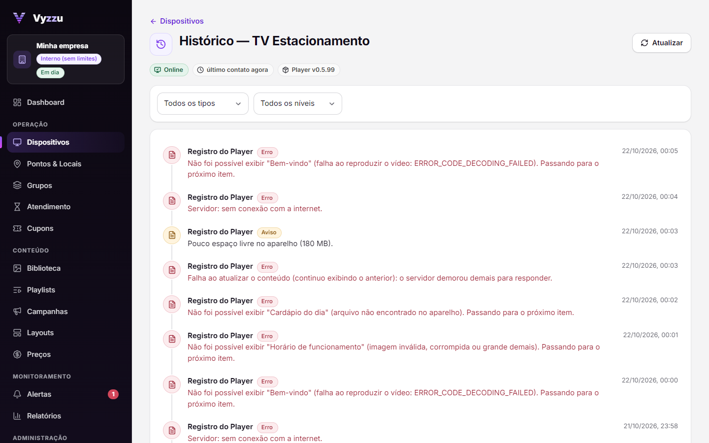

> Os horários dos registros do Player vêm do **relógio da TV**. Se a TV estiver com a hora muito errada, o painel usa a hora do servidor para não bagunçar a história.

Em **Dispositivos**, a linha da TV também mostra **"Na tela: …"** (com o ícone de play): a mídia que o Player disse estar exibindo no último contato.

**Diagnóstico da TV.** No alto do Histórico há o cartão **Diagnóstico da TV**: o último relatório que a própria TV montou, num texto curto que serve ao suporte. Cada linha começa com **OK** ou **!!** (problema) e mostra: **internet**, se o **servidor** responde (e há quanto tempo), **espaço livre** e quanto conteúdo está guardado, a **última sincronização**, **o que falta baixar**, a versão do Player, o modelo, o Android e a memória, e as **permissões** (iniciar com a TV, sobrepor outros apps e instalar apps, que o Player precisa para voltar sozinho e se atualizar). O selo no alto diz **Tudo certo** ou quantos itens estão com problema. O botão **Copiar relatório** coloca o texto na área de transferência para colar no atendimento. O botão **Pedir diagnóstico agora** (Administrador) faz a TV mandar um relatório novo no próximo contato, em até 30 segundos, **sem ninguém precisar estar na frente dela**.

### 9.2 Alertas

Abra **Alertas** no menu. O painel abre um alerta **sozinho** quando:

| Alerta | Quando abre (padrão) |
|---|---|
| **TV sem contato** | A TV fica mais de **10 minutos** sem falar com o servidor (você pode mudar, de 2 minutos a 24 horas). |
| **TV nunca conectou** | Uma TV foi ativada, mas não fez o primeiro contato em **24 horas**. |
| **Erros no Player** | A TV relata **5 erros** em 10 minutos. |

O alerta **fecha sozinho** quando o problema acaba (a TV volta, faz o primeiro contato ou para de dar erro) e some da lista de abertos; desmarque **Só os abertos** para ver também os resolvidos. Se a TV cair de novo, abre-se um alerta novo. TVs **desativadas** não geram alerta. O número de alertas abertos aparece no **Dashboard**.

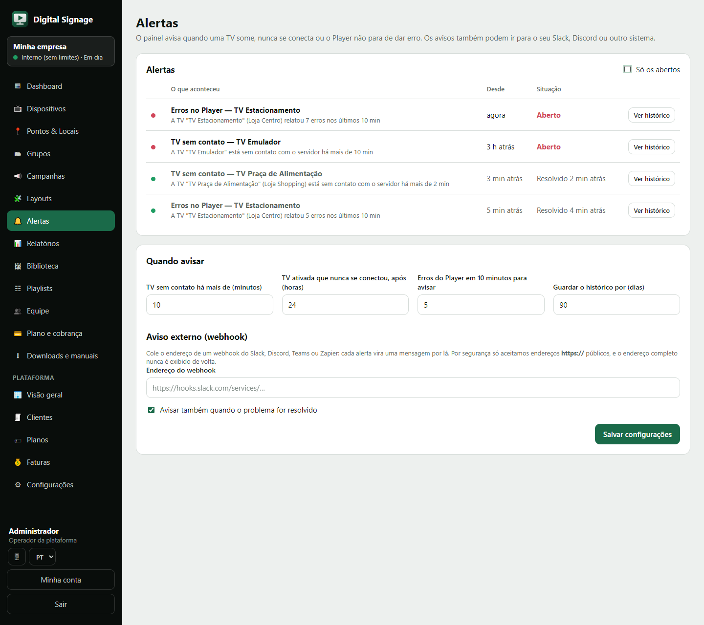

Em **Quando avisar** você muda os três limites acima e por quanto tempo o painel **guarda o histórico** (padrão 90 dias; o que passa disso é apagado sozinho). **Ver histórico** leva direto à linha do tempo da TV.

#### Receber os alertas por e-mail

Em **Aviso por e-mail** digite o endereço que deve receber os avisos de TV fora do ar (até **3**, separados por vírgula) e clique em **Salvar configurações**. Cada alerta que abre vira um e-mail, e (se **Avisar também quando o problema for resolvido** estiver marcado) outro quando ele fecha. **Enviar e-mail de teste** manda um e-mail de verdade para o endereço já salvo, para você conferir que chega (olhe o spam na primeira vez).

- Se aparecer o aviso amarelo **"O envio de e-mail ainda não foi ativado neste servidor"**, o endereço fica salvo, mas nada sai até o envio ser ativado (quem cuida do servidor faz isso uma vez; veja `docs/EMAIL.md`).
- O e-mail e o webhook funcionam juntos: pode usar os dois, um deles ou nenhum.
- Se o provedor de e-mail estiver fora do ar, o painel tenta de novo a cada minuto e **desiste depois de 1 hora** (o alerta continua na lista).

#### Receber os alertas no Slack, Discord, Teams…

Em **Aviso externo (webhook)** cole o endereço de um *webhook de entrada* do seu aplicativo de mensagens (no Slack: *Apps → Incoming Webhooks*; no Discord: *Editar canal → Integrações → Webhooks*). Cada alerta vira uma mensagem por lá, e (se você deixar marcado) também o aviso de que foi **resolvido**. Clique em **Enviar teste** para conferir que chega.

- Só são aceitos endereços **https://** públicos. Por segurança o servidor **não** envia para endereços internos (como `localhost` ou `192.168…`).
- O endereço completo é um **segredo** (quem o tem consegue postar no seu canal): depois de salvo o painel mostra só o servidor e o final dele e **nunca** o exibe de volta. Para trocar, cole um novo; para parar de avisar, **Remover webhook**.
- Se o webhook estiver fora do ar, o painel tenta de novo a cada minuto e **desiste depois de 1 hora** (o alerta continua na lista).

### 9.3 Relatórios

Abra **Relatórios**. São cinco, cada um com período (**Hoje**, **7 dias**, **30 dias** ou datas à escolha, no fuso de Brasília) e **Baixar CSV**, que gera uma planilha com os mesmos filtros que estão na tela (abre direto no Excel em português):

- **Disponibilidade:** por TV e da frota inteira, quanto do tempo observado ela ficou online, quanto offline e quantas quedas teve. Dá para filtrar por local e grupo. A TV só é medida **a partir do primeiro contato** (uma TV nova não nasce com 0%) e o tempo em que esteve **desativada não conta**. Uma TV sem nenhum dado no período aparece como "sem dados", não como 0%.

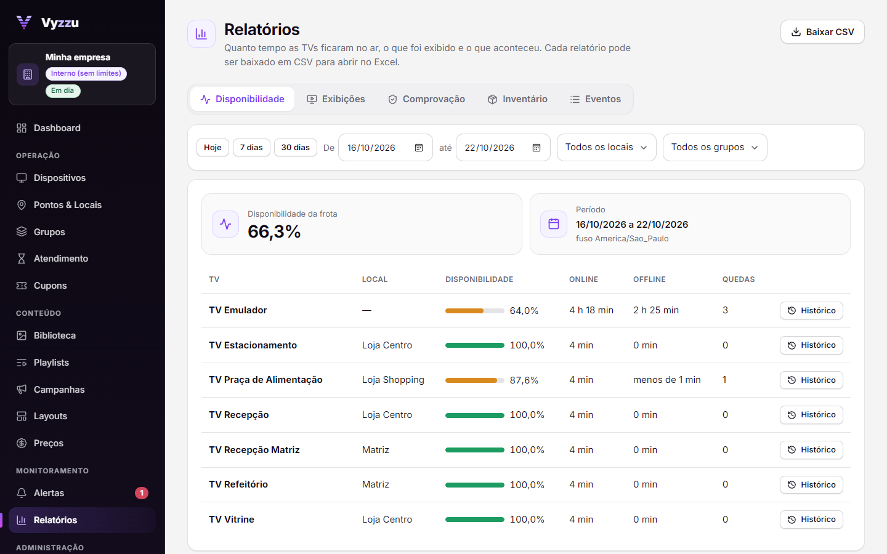

- **Exibições:** quantas vezes cada **mídia** foi exibida até o fim e por quanto tempo, agrupado por mídia, por TV ou por dia. Uma exibição só conta quando a mídia **termina**; vem das TVs com Player 0.5 ou mais novo.

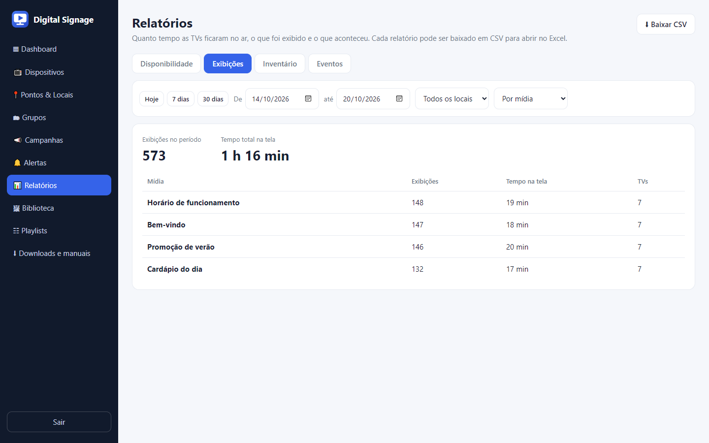

- **Comprovação:** o registro **exato** de cada vez que uma mídia foi ao ar numa TV: dia e hora **com milissegundos**, duração real (e a prevista), zona, campanha e se foi **até o fim ou interrompida**. A própria TV mede e guarda tudo (mesmo sem internet) e entrega ao servidor no contato seguinte. Detalhes na seção 9.4.
- **Inventário:** uma foto de agora de todas as TVs: local, grupos, situação, versão do Player, **equipamento** (modelo, versão do Android e memória, que o próprio Player informa), playlist exibida (e a campanha, se houver) e a mídia na tela. Para o **Administrador** aparecem também o **número de série**, a data de instalação e a observação de comodato, que ele preenche em **Dispositivos > Editar** (campos **Número de série**, **Instalada em** e **Comodato / observação**; os outros papéis não veem esses três). O CSV leva as mesmas colunas: serve de controle do que está em comodato em cada cliente. O modelo, o Android e a memória aparecem também no alto do **Histórico** da TV; uma TV com Player antigo mostra o equipamento depois de atualizar o Player.

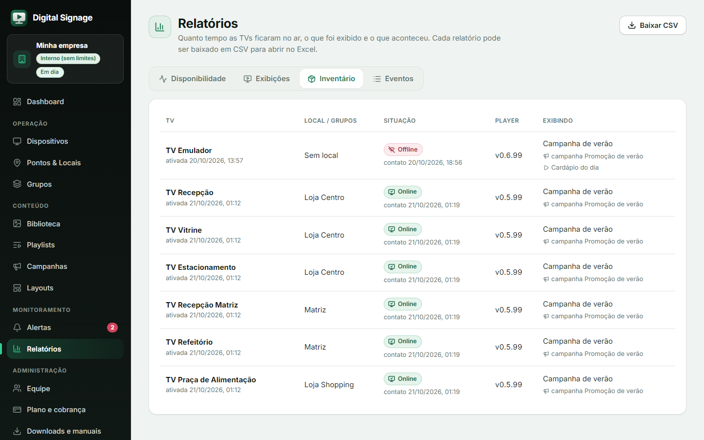
- **Eventos:** o histórico de todas as TVs juntas, filtrável por TV, tipo e nível. Na tela aparecem os 500 mais recentes; o CSV traz até 20.000.

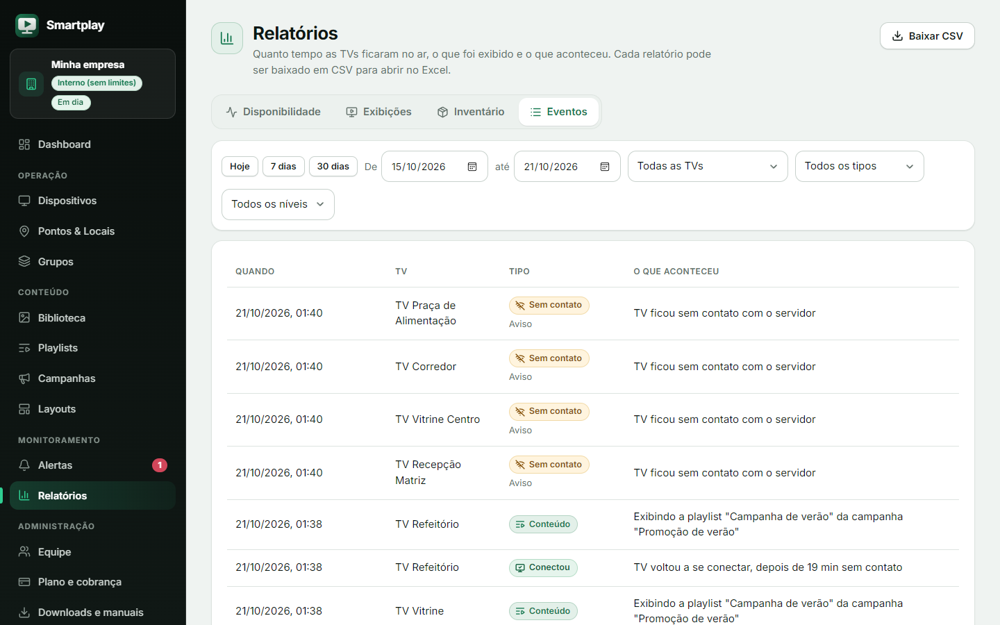

> **Cuidado ao abrir o CSV:** textos que começam com `=`, `+`, `-` ou `@` ganham um apóstrofo no começo (`'=…`) de propósito, para o Excel não executá-los como fórmula.

### 9.4 Comprovação de exibição (proof of play)

Para anunciantes e contratos: a aba **Comprovação** mostra cada exibição, uma por linha, com o início em **milissegundos** (`05/11/2026 12:00:00,123`), a duração medida pela TV (`10,012 s`, ao lado da prevista), a zona da tela, a campanha, o resultado (**Completa** ou **Interrompida**) e o **registro** (número de ordem + início do hash). Filtre por **TV**, **mídia** e **campanha**; o período é o do topo da tela (no máximo 93 dias por consulta) e **Carregar mais** traz as próximas 100 linhas. **Baixar CSV** gera a mesma lista (até 100.000 linhas).

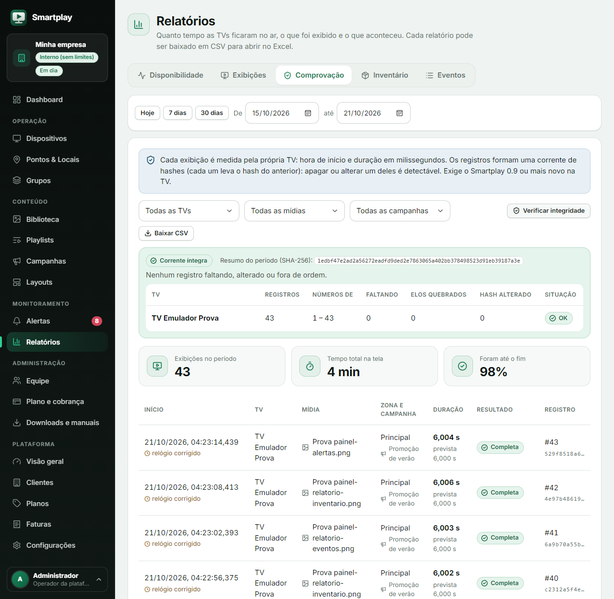

**Como saber que ninguém mexeu nos números:** cada registro leva o número de ordem da TV (1, 2, 3…) e o *hash* (SHA-256) do registro anterior. Apagar, trocar ou reordenar um registro quebra todos os seguintes. **Verificar integridade** recalcula a corrente do período e diz, por TV, quantos registros existem, se falta algum número, se há elo quebrado ou hash alterado, e mostra o **resumo do período** (SHA-256). **Guarde esse resumo junto com o relatório entregue ao cliente**: com ele se prova, depois, que nenhum registro do período mudou. Linhas com problema ficam marcadas em vermelho.

- **Relógio da TV errado:** o horário vem do relógio da TV; se ele estiver desajustado em mais de 2 segundos, o servidor corrige o início usando a hora dele e a linha mostra "relógio corrigido". A duração não muda (é medida por um cronômetro, não pelo relógio).
- **TV sem internet:** os registros ficam guardados na TV (até 20.000, em arquivo que sobrevive a queda de energia e a reinício) e seguem quando a internet voltar. Se passar do limite, os mais antigos são descartados e isso aparece no histórico da TV.
- **Quanto tempo fica guardado:** o detalhe linha a linha fica **7 dias** em clientes novos (ajustável de 7 a 365 em **Alertas > Guardar cada exibição por (dias)**; clientes anteriores mantêm o prazo que já tinham). Abaixo da tabela, o **resumo por dia** (exibições, tempo na tela e o último hash de cada dia) fica **um ano**.
- **Exige o Vyzzu 0.9 ou mais novo na TV.** TVs com versão anterior continuam aparecendo em **Exibições** (contagem), mas não em **Comprovação**.

---

## 10. Layouts, QR Code e páginas da web

Até aqui cada TV mostrava **um conteúdo só, em tela cheia**. Com **layouts** você divide a tela em **zonas**: por exemplo, o conteúdo principal à esquerda e, à direita, uma faixa com avisos, um QR Code ou uma página da web. Cada zona toca a sua própria lista **ao mesmo tempo**.

### 10.1 Layouts

Abra **Layouts** no menu. Cada cartão mostra um desenho da divisão da tela, quantas zonas tem e quantas TVs o usam.

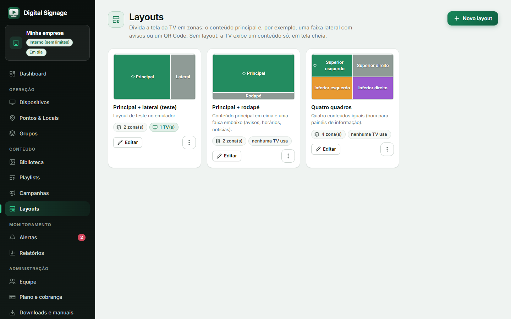

**Criar um layout**

1. Clique em **Novo layout** e escolha um **modelo pronto**: *Tela cheia*, *Principal + faixa lateral*, *Principal + rodapé*, *Principal + lateral + rodapé*, *Duas metades*, *Quatro quadros* ou *Totem em pé*. Os modelos marcados com **inclui versão em pé** já vêm com a divisão para TV na vertical (veja 10.1.1). Dê um nome e clique em **Criar e ajustar**. (Ou **Começar do zero**.)

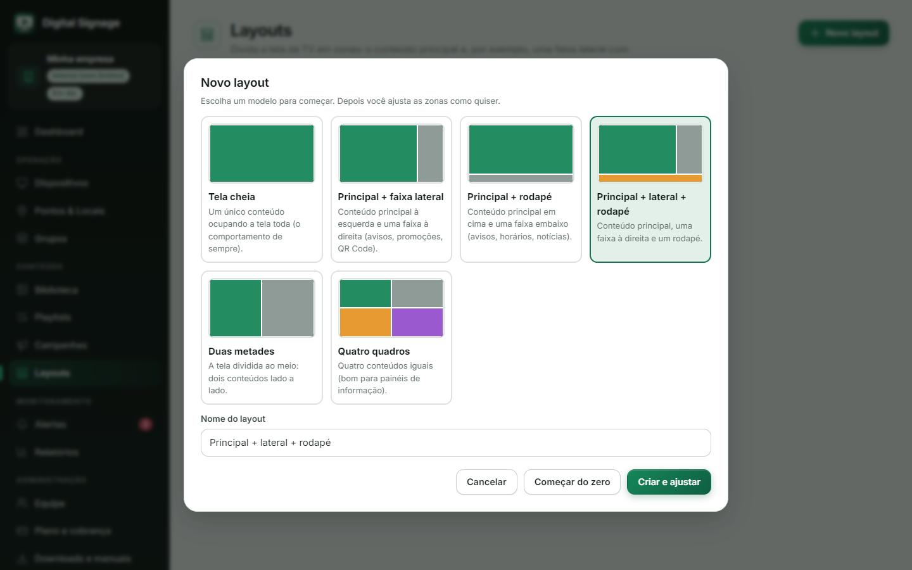

2. No editor, o desenho no alto mostra a tela. Para cada zona você define o **nome**, a **posição** (X e Y) e o **tamanho** (largura e altura), tudo em **% da tela** a partir do canto superior esquerdo. O desenho se atualiza enquanto você digita, e o painel avisa na hora se alguma zona sai da tela ou se sobrepõe a outra.
3. Marque qual zona é a **principal**. Ela exibe **a playlist da TV** (e as campanhas, veja abaixo). Nas **outras zonas** escolha uma **playlist fixa** (ou deixe "Sem conteúdo").
4. **Salvar.** As TVs que usam o layout atualizam sozinhas em até 1 minuto.

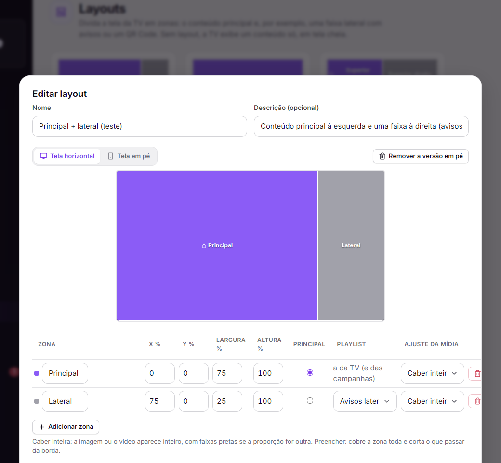

**Regras do layout:** de 1 a 6 zonas; exatamente uma zona principal; as zonas não podem se sobrepor nem sair da tela; cada uma tem no mínimo 5% de largura e de altura. Essas regras valem separadamente para a versão horizontal e para a versão em pé.

#### 10.1.1 TV em pé (totem, painel na vertical) e ajuste da mídia

Uma faixa lateral que fica boa numa TV deitada vira um "canudo" numa TV em pé. Por isso um layout pode ter **duas versões**: a **horizontal** (a de sempre) e uma **em pé**, e a TV usa a que combina com a forma em que ela foi instalada: em **Dispositivos**, **Editar**, **Como a TV foi instalada** (veja 5.6.3).

1. No editor do layout, escolha **Tela em pé** no alto (ao lado de **Tela horizontal**) e clique em **Criar a versão em pé**. O painel começa com a horizontal "deitada" (uma lateral vira um rodapé, duas metades viram uma em cima da outra), e o desenho passa a ser 9:16. Ajuste posição, tamanho e playlists como na horizontal.
2. **Salvar.** As TVs em pé passam a mostrar a versão em pé; as deitadas continuam com a horizontal.
3. **Remover a versão em pé** volta ao comportamento antigo: a TV em pé usa a horizontal.

Sem versão em pé, a TV em pé continua mostrando o layout horizontal como antes. A **zona principal** das duas versões mostra a mesma playlist da TV (e a campanha, quando vale).

**Ajuste da mídia** (uma opção por zona, nas duas versões):

- **Caber inteira (com faixas)**: a imagem ou o vídeo aparece **inteiro**; se a proporção da mídia não for a da zona, sobram faixas pretas. É o padrão e o comportamento de sempre.
- **Preencher (corta as bordas)**: a mídia cobre a zona toda e o que passa da borda é cortado. Fica bonito em fotos e vídeos; **não use** em imagens com texto perto da borda.

**Usar o layout numa TV:** em **Dispositivos**, clique em **Editar** na TV e escolha o **Layout da tela** (ou **Tela cheia** para voltar ao normal). Para várias TVs de uma vez, marque-as e use **Aplicar layout…** na barra violeta. A TV mostra um selo com o ícone de layout e o nome dele, e o **Histórico** dela registra a mudança.

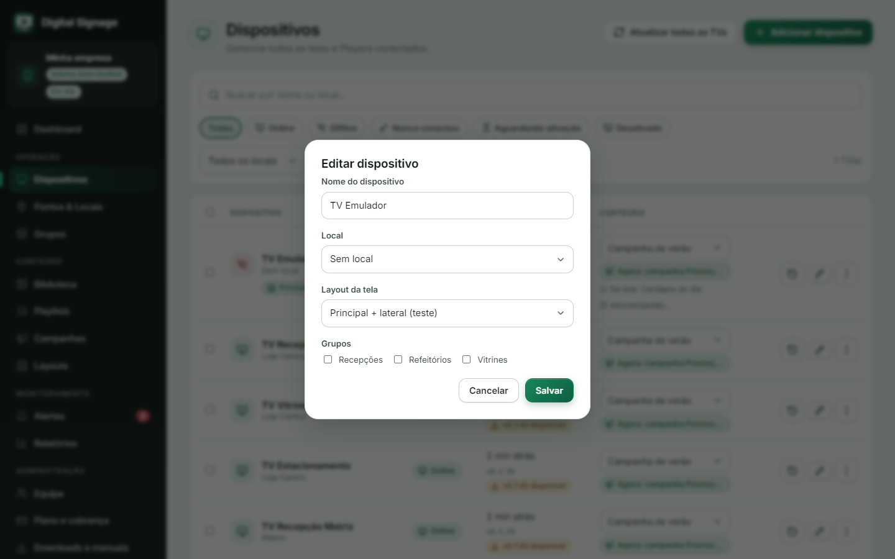

**Como o layout convive com as campanhas e playlists**

- A **zona principal** exibe a playlist da TV; quando uma **campanha** vale, ela substitui a playlist **só na zona principal**. As outras zonas continuam com a playlist fixa delas.
- Uma playlist usada numa zona **não pode ser excluída** enquanto o layout a usar (o painel diz qual). E um layout **em uso por TVs** não pode ser excluído: tire as TVs dele antes.

**Dicas para um bom resultado**

- As imagens são exibidas **inteiras** (sem cortar): numa faixa estreita, uma imagem 16:9 fica pequena. Para as faixas, prepare imagens do **formato da zona** (quadradas ou verticais) — e os **QR Codes** já são quadrados.
- Use **vídeo em uma zona só** (de preferência a principal). Aparelhos baratos nem sempre aguentam dois vídeos ao mesmo tempo, e **só a zona principal toca o som**.
- Em cada zona as mídias passam em loop, cada uma no seu tempo.

### 10.2 QR Code

Em **Biblioteca**, clique em **QR Code**. Digite o **endereço ou texto** (um cardápio, o Wi‑Fi do local, um WhatsApp…), um **título** e uma **legenda** (opcionais) e escolha as **cores**: os visuais prontos (Claro, Escuro, Violeta, Verde) ou **Personalizado**, em que você escolhe o **Fundo**, o **Texto** (título e legenda), o **Cartão do código** e o **Código**. A pré-visualização aparece na hora. **Salvar na biblioteca** guarda o QR Code como uma **imagem** comum: coloque-a em qualquer playlist (a de uma zona lateral é uma ótima ideia).

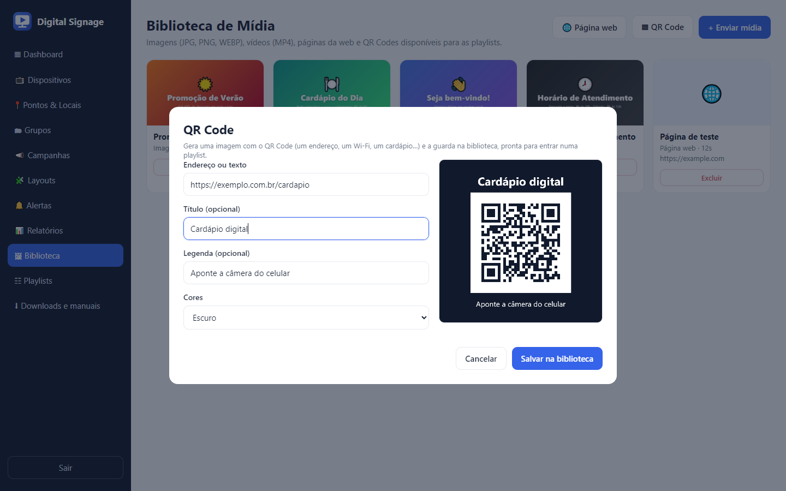

O código precisa ficar **mais escuro que o cartão** e com bom contraste (celulares só leem assim): se as cores escolhidas não permitirem, o painel explica e **não deixa salvar**. Ele guarda as suas cores para a próxima vez, neste navegador. Teste lendo o QR Code com o seu celular antes de publicar.

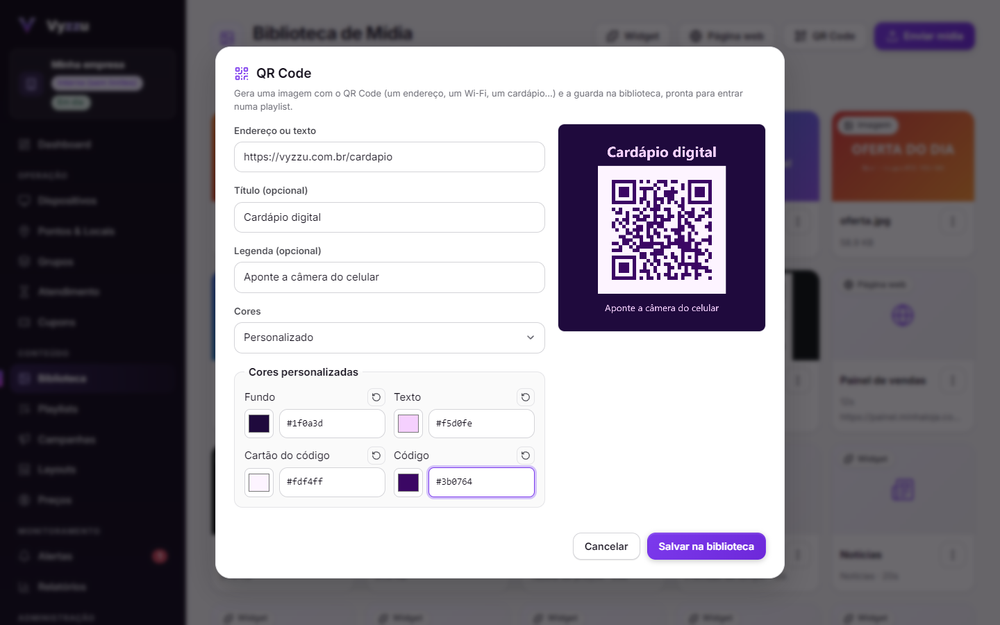 Textos muito longos não cabem num QR Code: prefira um endereço curto.

### 10.3 Página da web

Em **Biblioteca**, clique em **Página web**. Informe o **endereço** (precisa começar com **https://**), um **nome** e por quantos **segundos** a página fica na tela (de 5 a 3600; o padrão é 30). Ela entra na biblioteca como qualquer mídia e pode ser colocada em qualquer playlist: um painel de vendas, a previsão do tempo, um cardápio online…

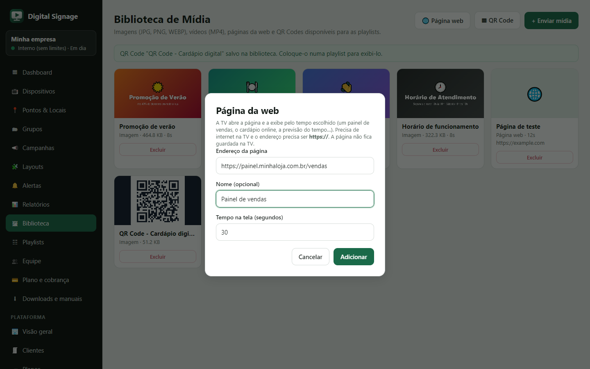

- A **TV precisa de internet** para abrir a página (ela **não fica guardada** na TV como as imagens e vídeos). Se a página não abrir (sem internet, erro do site), a TV **pula** para o próximo item e o erro aparece no **Histórico** da TV.
- O Player **só abre endereços https** e a página roda **sem interação** (ninguém clica nela). Não use páginas que exigem login digitado na TV.
- A página é exibida **no tamanho da zona**: sites feitos para celular costumam ficar bem em uma faixa lateral.
- Os relatórios de **exibições** contam também as páginas.

> **Requisito:** layouts, QR Code e páginas da web exigem o Player **0.6 ou mais novo** nas TVs. Use **Atualizar app** em **Dispositivos**. Um Player mais antigo ignora o layout e mostra a zona principal em tela cheia (e não exibe as páginas da web).

### 10.4 Atendimento: fila de senhas e painel de chamadas

Para lojas, clínicas, cartórios e qualquer lugar com fila: o Vyzzu emite **senhas**, o atendente **chama a próxima** e a TV mostra, em poucos segundos e com um aviso sonoro, **qual senha foi chamada e em qual guichê**. Tudo fica em **Atendimento**, no menu **Operação**.

**1. Montar as filas e os guichês (Administrador).** Em **Atendimento**, clique em **Filas e guichês**.

- **Fila:** um nome (por exemplo *Atendimento geral*) e uma **letra de 1 a 3 caracteres** (A, P, VIP). As senhas ficam **A001, A002...** e a numeração **recomeça todo dia**. Marque **Fila prioritária** para idosos, gestantes e pessoas com deficiência.
- **Guichê:** um nome (*Guichê 1*, *Mesa da recepção*) e as **filas que ele atende** (sem nenhuma marcada, atende todas).

**2. Emitir senhas.** Em **Atendimento**, escolha a fila (botão com a letra) e, se quiser, escreva o **nome da pessoa** antes (só os atendentes veem). A senha entra na **Fila de espera**, por ordem de chegada. Quem desistiu sai da fila com o **X**.

**3. Chamar (atendente).** Escolha o seu **guichê** (o painel lembra no seu navegador) e use:

| Botão | O que faz |
|---|---|
| **Chamar a próxima senha** | Chama a senha que espera há mais tempo nas filas do seu guichê. Duas pessoas chamando ao mesmo tempo **nunca pegam a mesma senha**. |
| **Chamar de novo** | A TV toca o aviso outra vez para a mesma senha (a pessoa não ouviu). |
| **Iniciar atendimento** | A pessoa chegou ao guichê. |
| **Concluir** | Termina o atendimento e libera o guichê para a próxima. |
| **Não compareceu** | A pessoa foi chamada e não apareceu. |

**Prioridade, sem deixar ninguém para trás.** As filas prioritárias são chamadas primeiro, mas **a cada 3 chamadas prioritárias seguidas é chamada uma senha normal** (se houver), para a fila normal nunca ficar parada. Dentro de cada grupo vale a ordem de chegada.

**4. Mostrar na TV: o painel de chamadas.** Em **Biblioteca**, clique em **Widget** e escolha **Painel de chamadas**: dê um título, marque as filas (ou nenhuma, para todas), o número de chamadas na lista (3 a 8) e se a TV deve **tocar um aviso** a cada chamada. Coloque o widget **sozinho numa playlist** e a playlist numa **zona de um layout** (por exemplo, a lateral direita) ou na TV inteira. Enquanto está na tela, o painel **se atualiza em até 3 segundos**: mostra a senha chamada em letras grandes, o guichê e as últimas chamadas, e a senha **pisca por 20 segundos** para chamar a atenção.

**5. Senha pelo celular (QR Code).** Na janela da fila (Administrador), marque **Permitir pegar a senha pelo celular (QR Code)** e salve; abra a fila de novo para ver o **QR Code** e o **endereço**: **Baixar o QR Code**, imprimir e colar perto da entrada (ou **Copiar o endereço** e mandar por mensagem). Quem escanear:

1. Vê o nome da fila e quantas pessoas aguardam, escreve o nome (opcional) e toca em **Pegar minha senha**.
2. Fica numa página que **se atualiza sozinha** com a senha em letras grandes e **quantas pessoas estão na frente**. Quando o atendente chama, a página mostra **"É a sua vez! Vá ao Guichê 2"** e o celular **vibra**. Dá para **Sair da fila** enquanto a senha ainda não foi chamada.
3. Se escanear de novo, volta para a mesma senha (não emite outra). Terminado o atendimento, pode pegar uma nova.

A senha pelo celular aparece na **Fila de espera** como as outras (com o nome, que só os atendentes veem). **Segurança:** o QR Code leva um código secreto da fila; quem o tiver pode pegar senha, então imprima só onde o cliente está. Cada celular pode pegar **até 4 senhas por hora** por fila (o aparelho é reconhecido por um código guardado no navegador, então clientes no mesmo Wi-Fi da loja não atrapalham uns aos outros), uma mesma rede **até 60 por hora**, e a fila aceita **até 300 senhas de celular esperando** ao mesmo tempo. **Desligar** a opção fecha a página na hora (os QR Codes impressos deixam de funcionar até religar). O QR Code só pode ser visto pelo Administrador.

**Números do dia.** No alto da página: senhas emitidas, atendidas, aguardando, quantas **não compareceram**, a **espera média** e o **atendimento médio**.

**Quem pode o quê.** O **Visualizador** só acompanha; o **Editor** emite, chama e conclui senhas; o **Administrador** monta as filas e os guichês. Por enquanto o atendente precisa do papel **Editor** (que também mexe em conteúdo); um papel só para atendimento é um próximo passo.

**Privacidade.** O nome digitado na senha é um dado pessoal: as senhas são **apagadas depois de 30 dias** (o Administrador muda esse prazo em **Privacidade e dados**, seção 11.4). Quem pega a senha **pelo celular** vê um aviso de privacidade e só consegue informar o nome se marcar que concorda; sem nome, nada é coletado. Prefira não pedir o nome quando não for necessário.

> **Requisito:** o painel de chamadas na TV exige o Player **0.14 ou mais novo** (Dispositivos > **Atualizar app**). **Limites desta versão:** o aviso é um **duplo bip** (a TV não fala o número); a TV precisa de internet para se atualizar (sem internet ela mostra a última chamada que recebeu).

---

### 10.5 Cupons para os clientes da loja

Em **Cupons** (menu Operação) você cria promoções para os clientes da sua loja: o cliente **escaneia um QR Code na TV** (ou impresso), recebe no celular um **cupom com código único** e o **caixa dá baixa** no painel. Não precisa instalar nada e o cliente não precisa de login. (Não confunda com os cupons de assinatura do capítulo 12, que dão desconto na mensalidade do próprio painel.) O recurso depende do plano.

**Montar a promoção:** *Nova promoção* pede o nome, as regras que o cliente lê (opcional), quando começa e termina (opcionais), **quantos dias o cupom vale depois de pego** (7 por padrão; nunca passa do fim da promoção) e **quantos cupons no total** (vazio = ilimitado). Salve e abra a promoção de novo: aparecem o **QR Code** (para baixar e enviar à Biblioteca, como imagem, e mostrar na TV; ou imprimir) e o **endereço** que ele abre.

**O que o cliente vê:** a promoção e as regras, o campo "Seu nome (opcional)" e o botão **Pegar meu cupom**. Em seguida aparece o código grande (ex.: `K7QP-2WXD`), até quando vale e, depois, se já foi usado ou venceu; a página se atualiza sozinha. Escanear de novo com o mesmo celular mostra **o mesmo cupom** (não gera outro). Quem apaga os dados do navegador pode pegar outro: o que segura isso é o **limite de cupons** da promoção e um teto por rede (a rede de visitantes de uma loja é um endereço só, então o teto é alto).

**Dar baixa no caixa:** digite o código em **Dar baixa no caixa** (vale minúscula, sem hífen ou com espaço) e clique em **Conferir**: aparecem a promoção, o nome do cliente (se ele informou) e a validade. Se estiver valendo, **Dar baixa neste cupom** o marca como usado, **uma vez só** (se dois caixas lerem o mesmo código ao mesmo tempo, só um consegue). Cupom já usado ou vencido é recusado com o motivo. Quem tem papel de Editor ou mais dá baixa; o Visualizador só consulta.

**Acompanhar:** a lista mostra, por promoção, os cupons pegos, os usados, a validade e a situação (*No ar*, *Programada*, *Encerrada*, *Cupons esgotados*, *Desligada*); **Ver os cupons** lista os códigos com a situação. Para encerrar uma promoção sem apagar o histórico, **desligue-a** (quem já pegou o cupom continua com ele). Uma promoção que já teve cupons pegos não se exclui.

**Dados pessoais:** o nome é opcional, aparece junto de um aviso de privacidade (a pessoa precisa marcar que concorda para informá-lo) e é apagado depois de 90 dias por padrão (o Administrador muda esse prazo em **Privacidade e dados**, seção 11.4); o cupom em si fica só com o código e as datas.

## 11. Equipe e papéis

Cada pessoa entra no painel com o **seu próprio e-mail e senha**, e o **papel** dela decide o que pode fazer. Assim o dono do cliente dá acesso à equipe sem entregar a senha de administrador.

### 11.1 Os papéis

| Papel | O que pode |
|---|---|
| **Visualizador** | Só consulta: vê as TVs, a biblioteca, playlists, campanhas, layouts, alertas, relatórios e o histórico. Não altera nada. |
| **Editor** | Tudo do Visualizador **e** cuida do conteúdo: envia e exclui mídias, monta playlists, campanhas e layouts, e escolhe a **playlist e o layout** de cada TV (também em várias TVs de uma vez). Também **emite e chama senhas** no **Atendimento**. |
| **Administrador** | Tudo do Editor **e** administra o cliente: ativa, renomeia, move, desativa e exclui TVs, cria locais e grupos, pede atualização do aplicativo, configura os alertas e gerencia a **Equipe** e o **Plano e cobrança**. |

O painel **só mostra os botões que o seu papel pode usar**. Se alguém tentar o que não pode (por exemplo, por um endereço antigo), o servidor recusa e o painel avisa em português.

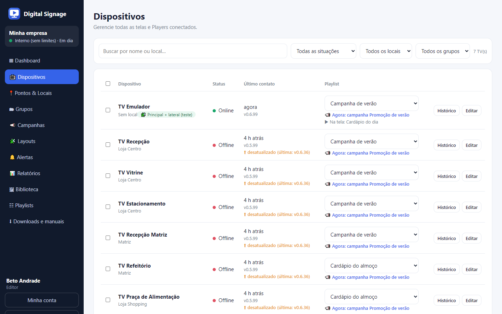

### 11.2 Gerenciar a equipe (Administrador)

Em **Equipe** estão todas as pessoas do cliente, com o papel e a situação de cada uma. No alto aparece quantos usuários o plano permite (ex.: "2 de 5").

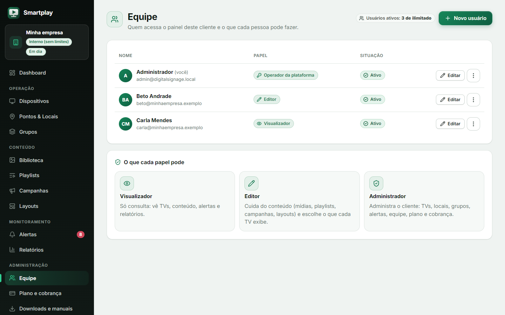

- **Novo usuário:** informe o nome, o **e-mail** (é o login), o **papel** e uma **senha inicial** (mínimo de 8 caracteres). Combine com a pessoa e peça que a troque em **Minha conta**. Se o envio de e-mail estiver ativado, a pessoa também recebe um e-mail de boas-vindas com um link (vale 3 dias) para escolher a própria senha, e a senha inicial nem precisa ser combinada.
- **Editar:** muda o nome e o papel, **desativa** o acesso (a pessoa deixa de entrar, mas o cadastro fica) ou define uma nova senha (útil quando alguém esquece a dela). Deixe a senha em branco para mantê-la.
- **Excluir:** remove a pessoa. O acesso acaba na hora.
- Você **não pode excluir nem desativar a si mesmo**, e o cliente **sempre mantém pelo menos um administrador ativo** (para tirar o papel do último, promova outra pessoa antes).

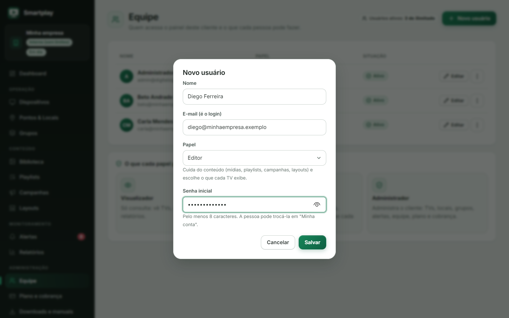

> Se o plano já está com todos os usuários em uso, o painel avisa ("O plano … permite até N usuário(s)"). Desative alguém que não usa mais o painel ou peça um plano maior (capítulo 12).

### 11.3 Minha conta: trocar a própria senha

Em qualquer papel, clique no seu **nome** (pé do menu à esquerda; no celular, a bolinha do alto) e em **Minha conta**, digite a **senha atual** e a **nova senha duas vezes** (mínimo de 8 caracteres). O **tema** e o **idioma** ficam no mesmo menu (seção 2.2 e 2.3).

### 11.4 Privacidade e dados (LGPD)

Em **Administração → Privacidade e dados** (só o **Administrador**, que é quem lida com a LGPD na empresa). A tela tem três partes:

**Contato do aviso de privacidade.** O nome e o e-mail de quem responde pelos dados da sua empresa. Eles aparecem no aviso das páginas públicas da fila e do cupom, para a pessoa saber com quem falar.

**Por quanto tempo guardamos.** Quatro prazos, em dias: **senhas da fila** (a senha inteira, com o nome, é apagada; padrão 30), **nome nos cupons** (o cupom fica, sem identificar a pessoa; padrão 90), **histórico das TVs** (padrão 90) e **exibições detalhadas** (padrão 14). Passado o prazo, o que é pessoal é apagado **sozinho** (a limpeza roda de hora em hora). Prazos menores guardam menos dados.

**Pedido de um titular.** Quando uma pessoa pedir cópia ou exclusão dos dados dela:

1. Confirme quem está pedindo (o sistema não faz isso por você).
2. Digite o **nome**, o **e-mail** ou o **código do cupom** (pelo menos 3 caracteres) e clique em **Buscar**: aparecem as **senhas da fila**, os **cupons** e os usuários da **equipe** que combinam. Confira.
3. Escreva uma **observação** (por exemplo, o protocolo do pedido) e clique em **Baixar cópia dos dados (JSON)** para entregar à pessoa, ou em **Apagar dados pessoais encontrados** (pede confirmação e **não tem volta**): o nome, o aparelho e a concordância somem das senhas e dos cupons, que continuam existindo, sem identificar ninguém, para os números do atendimento.
4. Para tirar um usuário do painel, use **Equipe**: nesta tela ele só entra na cópia dos dados.
5. Responda à pessoa em até **15 dias**.

Cada cópia ou exclusão fica na lista **Pedidos atendidos** (tipo, quantidades, observação e quem atendeu). **O nome buscado não é guardado.** Nas páginas públicas, o aviso mostra o nome da sua empresa como responsável, o contato que você definiu, por quantos dias o nome fica e um link para a **Política de Privacidade**; a política e os **Termos de Uso** podem ser abertos por qualquer pessoa em `/privacidade` e `/termos`, sem entrar. O mapa completo dos dados está em `docs/LGPD.md`.

---

## 12. Plano e cobrança

Para o **Administrador** do cliente. Mostra o plano contratado, o quanto você já usa dele, as faturas e como pagar.

### 12.1 Plano e uso

Cada plano tem **limites**: de **TVs** ativadas, de **espaço de mídias** e de **usuários**. As barras mostram o quanto você já usou (verde, laranja a partir de 80% e vermelho quando enche). Um limite "ilimitado" não tem barra para encher.

Quando um limite é atingido, o painel **recusa o que passaria dele**, explicando o motivo e o que fazer:

| Limite | O que acontece ao passar |
|---|---|
| **TVs** | Não é possível ativar mais uma TV. Exclua uma que não usa ou peça um plano maior. |
| **Espaço de mídias** | O envio é recusado. Exclua mídias que não usa mais ou peça um plano maior. |
| **Usuários** | Não é possível adicionar mais um. Desative alguém ou peça um plano maior. |

O que já existe **nunca é apagado** por causa de um limite: as TVs continuam exibindo normalmente.

Além dos limites, cada plano **inclui ou não alguns recursos**: Campanhas, Layouts com zonas, Widgets, Tabelas de preços, Fila de atendimento, Comprovação de exibição e Cupons para clientes. O que o seu plano não inclui **some do menu** e, se alguém abrir o endereço, aparece a mensagem "Este recurso não está no seu plano" com o caminho para ver os planos. Há também um **tamanho máximo para cada arquivo** enviado (quando o plano define um). Em "Planos disponíveis" cada plano mostra o que inclui, para você comparar antes de pedir a troca. Rebaixar de plano **não apaga nada**: o que já foi montado continua aparecendo nas TVs; só o painel deixa de oferecer o recurso novo.

### 12.2 Situação da assinatura

| Situação | O que significa |
|---|---|
| **Em teste** | Período de teste gratuito (14 dias para clientes novos). O painel avisa nos últimos 7 dias. No fim do teste, a primeira fatura é emitida. |
| **Em dia** | Tudo pago. |
| **Em atraso** | Há uma fatura vencida. O painel e as TVs **continuam funcionando** durante a tolerância (7 dias por padrão), com um aviso no alto da tela. |
| **Suspenso** | Passou a tolerância sem pagamento. O **painel fica bloqueado** (só "Plano e cobrança" abre), mas **as TVs continuam exibindo o que já têm**. |
| **Encerrado** | A conta foi encerrada pela operação: painel e TVs param. |

Planos **grátis** (preço zero) nunca geram fatura e ficam sempre em dia.

### 12.3 Faturas e como pagar

A lista mostra o número, a descrição, o vencimento, o valor e a situação de cada fatura (**A pagar**, **Vencida**, **Paga** ou **Cancelada**). O quadro **Como pagar** traz as instruções da operação (por exemplo, a chave PIX) e o e-mail de suporte.

1. Pague como indicado em **Como pagar**.
2. Envie o comprovante à operação, se ela pedir.
3. A operação **registra o pagamento**: a fatura vira **Paga**, o período é renovado e, se estava em atraso ou suspenso e não há outra fatura vencida, o cliente **volta ao normal** na hora (o painel atualiza sozinho).

> **O pagamento não é automático.** Esta versão não está ligada a um meio de pagamento (cartão, boleto ou PIX automático): a baixa é feita por uma pessoa da operação em **Plataforma → Faturas**.

### 12.3.1 Cupons

Se você recebeu um **código de cupom**, digite-o em **Plano e cobrança → Cupom** e clique em **Resgatar** (só o Administrador). O código vale com maiúsculas ou minúsculas. Um cupom pode dar:

| O que dá | Como funciona |
|---|---|
| **Desconto** (em porcentagem ou em valor) | Abate as **próximas faturas** (o cupom diz quantas). Se o desconto cobrir a fatura inteira, ela é dada como paga pelo cupom e o período já vale. Só um desconto por vez; planos gratuitos não têm o que abater. |
| **Dias grátis** | Empurra o fim do **teste** ou do **período já pago**. Não funciona com fatura em aberto: pague antes. |
| **Plano liberado por um tempo** | Você usa os limites e recursos de um plano maior até a data indicada; **o que é cobrado não muda**. Quando acaba, volta ao seu plano (nada que você montou é apagado). |

Cada cliente usa **cada cupom uma vez**. "Cupom inválido ou expirado" aparece quando o código não existe, foi desligado, passou da validade, ainda não começou ou já esgotou os usos (de propósito não se diz qual, para não ajudar quem tenta adivinhar). Depois de **10 códigos errados seguidos** o resgate fica bloqueado por cerca de uma hora. Os cupons já resgatados aparecem na própria tela, com o que ainda vale.

### 12.4 Trocar de plano e dados da conta

Em **Planos disponíveis** você compara preços e limites. O botão **Pedir este plano** abre um e-mail para a operação, que faz a troca. Em **Dados da conta** você ajusta o nome do cliente, o e-mail de cobrança e o CPF/CNPJ.

---

## 13. Plataforma (para quem opera o serviço)

Esta área aparece **só para o Gestor da plataforma**, quem vende e dá suporte ao serviço. Os clientes não a veem.

### 13.1 Visão geral

Mostra quantos **clientes** há (por situação), quantas **TVs** estão ativadas, a **receita mensal** dos planos pagos em dia e as **faturas** em aberto e vencidas. O botão **Rodar cobrança agora** executa o ciclo de cobrança na hora: o sistema também o roda sozinho **a cada hora** (emite faturas, marca atrasos e suspende quem passou da tolerância), e rodar de novo no mesmo dia não duplica nada.

### 13.2 Clientes

Cada cliente é uma empresa com os **seus próprios dados**: um cliente nunca vê as TVs, mídias ou usuários de outro.

- **Novo cliente:** informe o nome da empresa, o **plano** e o **primeiro administrador** (nome, e-mail e senha inicial). O cliente começa **em teste**. Envie o endereço do painel e esses dados ao administrador.
- **Editar:** muda o nome, o plano, a **situação** (por exemplo, reativar à mão ou suspender), o e-mail de cobrança, o CPF/CNPJ e as datas do teste e do período pago.
- **Nova fatura** (no menu **⋮** do cliente): cobrança avulsa (um serviço, uma instalação) com descrição, valor e vencimento. As mensalidades são geradas sozinhas.
- **Entrar:** abre o painel **como se fosse aquele cliente**, para dar suporte (ver ou ajustar TVs, playlists etc.). Enquanto estiver lá, um aviso violeta diz **"Você está atuando no cliente …"** e tudo o que você fizer vale para ele. Clique em **Voltar ao meu cliente** para sair. Isso vale só para a aba do navegador em que você entrou.

### 13.3 Planos

Define o **preço**, os **limites** (TVs, espaço em MB, usuários e tamanho máximo de cada arquivo) e **o que o plano inclui** (marque ou desmarque Campanhas, Layouts, Widgets, Tabelas de preços, Fila de atendimento, Comprovação de exibição e Cupons para clientes). Deixe um limite em branco para "ilimitado". Mudar um plano vale para todos os clientes que o usam **já na próxima ação deles**. O Gestor nunca é barrado, mesmo ao entrar num cliente cujo plano não inclui o recurso (para poder dar suporte). O **código** é um nome curto (ex.: `basico`); **ordem** define a posição na lista; planos **desativados** deixam de ser oferecidos a novos clientes (quem já está neles continua). Não dá para excluir um plano que ainda tem clientes.

### 13.3.1 Gestores

Em **Plataforma → Gestores** ficam as pessoas que operam o serviço. Cada gestor entra **com o próprio e-mail e senha** (não é preciso dividir o login) e tem acesso a tudo da plataforma. **Novo gestor** pede nome, e-mail (que é o login) e uma **senha provisória** de pelo menos 6 caracteres. Ao entrar pela primeira vez, a pessoa vê a tela **Defina a sua senha** e **precisa trocar a senha provisória** (a nova tem pelo menos 8 caracteres) antes de usar qualquer outra parte do painel. O mesmo vale quando você define uma senha nova para alguém que esqueceu a dela; a sua própria senha você troca em **Minha conta**. Em **Editar** dá para trocar o nome, definir uma senha nova (se ela esquecer) e **desativar** o acesso, que vale na hora. Você não consegue desativar nem excluir o seu próprio usuário (ficaria sem acesso).

### 13.3.2 Cupons de assinatura

Em **Plataforma → Cupons de assinatura** o gestor cria os cupons que os clientes resgatam em "Plano e cobrança" (ver 12.3.1).

- **Novo cupom:** o código (use **Gerar** para um aleatório), o que dá (desconto em porcentagem, desconto em valor, dias grátis ou plano liberado por um tempo), por quantas faturas ou dias vale, a validade (de/até, opcionais) e **quantos clientes podem usar** (vazio = ilimitado). Uma descrição só para você ajuda a lembrar para quê o cupom serve.
- **Gerar em lote:** de 1 a 500 códigos de uma vez, aleatórios e **de uso único** (cada código vale para um cliente só), com um começo opcional (ex.: `FEIRA-7K3Q-M9XD`) e o nome do lote. Os códigos aparecem numa caixa para **copiar todos** e entregar um a cada pessoa. Não usam letras que se confundem (0/O, 1/I/L), porque são digitados à mão.
- **Situação** de cada cupom: *Valendo*, *Programado* (ainda não começou), *Expirado*, *Esgotado* (os usos acabaram) ou *Desligado*. **Ver quem usou** (menu ⋮) mostra os clientes e as datas.
- Depois que alguém usa um cupom, **o que ele dá não muda mais** (quem já resgatou contou com isso): dá para ajustar a validade, o limite de usos, a descrição e ligar/desligar. Um cupom usado não se exclui: **desligue-o**.

### 13.4 Faturas e pagamentos

- Filtre por **A pagar**, **Pagas**, **Canceladas** ou veja **Todas**.
- **Registrar pagamento:** quando o dinheiro chegar, escolha a **forma** (PIX, boleto, transferência, cartão, dinheiro ou outra) e, se quiser, uma observação (ex.: "comprovante por e-mail"). A fatura vira **Paga**, o período do cliente é renovado e, se ele estava em atraso ou suspenso sem outra fatura vencida, volta a ficar **em dia**.
- **Cancelar:** para uma fatura emitida por engano. Uma fatura **paga** não pode ser cancelada.

### 13.5 Configurações da plataforma

- **Como pagar:** o texto que **todos os clientes** leem em "Plano e cobrança" (chave PIX, dados bancários, para onde enviar o comprovante).
- **Dias de teste:** duração do teste de um cliente novo (14 por padrão).
- **Dias de tolerância:** quantos dias após o vencimento o cliente ainda usa o painel antes de ser **suspenso** (7 por padrão).
- **Antecedência da fatura:** quantos dias antes do fim do período a fatura do mês seguinte é emitida (5 por padrão).
- **Privacidade (LGPD):** a **razão social**, o **CNPJ** e o **encarregado de dados (DPO)** com e-mail. Aparecem na Política de Privacidade e nos Termos de Uso, que qualquer pessoa abre sem entrar (`/privacidade` e `/termos`). Sem o e-mail do encarregado, a política mostra o e-mail de suporte.

---

## 14. Downloads e manuais

Em **Downloads e manuais** você encontra, sempre atualizados:

- o **aplicativo da TV** (APK) na versão mais recente, com o endereço curto para digitar no app Downloader da TV;
- as versões anteriores, caso precise voltar atrás;
- os manuais em **PDF** (este e o de instalação).

---

## 15. Avisos de erro

Quando algo dá errado, o painel mostra um aviso vermelho no alto da tela, em português, dizendo **o que aconteceu e o que fazer**. O aviso **fica na tela até você clicar em Fechar**.

Mensagens comuns:

Todo aviso começa pela **ação** que falhou (por exemplo, "Excluir mídia: …", "Carregar dispositivos: …").

| O aviso diz | O que significa | O que fazer |
|---|---|---|
| …o servidor demorou demais para responder | O servidor gratuito estava "dormindo". | Espere cerca de **1 minuto** e tente de novo. |
| …não foi possível conectar ao servidor | Falha na sua internet ou no servidor. | Confira a conexão; se o servidor estava inativo, aguarde cerca de 1 minuto. |
| …o servidor encontrou um erro (HTTP 5xx) | Problema temporário no servidor. | Tente de novo em instantes. |
| …sua sessão expirou. Entre novamente. | Passou muito tempo logado. | Entre de novo com e-mail e senha. |
| …existe outro registro que depende deste item | Você tentou excluir algo em uso (por exemplo, uma mídia que está numa playlist). | Retire o item de onde ele está sendo usado e tente de novo. |
| Ativar dispositivo: Código de ativação inválido ou expirado | O código da TV venceu ou foi digitado errado. | Confira o código na TV; se preciso, reinicie o Player para gerar outro. |
| …o arquivo é grande demais | A mídia passa do limite de tamanho. | Vídeos são reduzidos sozinhos ao enviar (veja o capítulo 3); se ainda assim passar de 50 MB, divida o vídeo em partes menores. Imagens: reduza e envie de novo. |
| …o plano … permite até N TV(s) / MB de mídias / usuário(s) | O limite do plano foi atingido. | Exclua o que não usa mais ou peça um plano maior (capítulo 12). |
| …a assinatura de "…" está suspensa | A cobrança está em atraso além da tolerância. | O administrador abre **Plano e cobrança**, paga a fatura e avisa a operação (capítulo 12). |
| …o papel Editor só pode… / …não tem permissão | O seu papel não permite essa ação. | Peça a um Administrador (capítulo 11). |

---

## 16. Boas práticas

- **Teste com uma TV primeiro**, depois replique para as outras (com grupos, aplicar a mesma playlist a todas é um clique).
- **Organize desde o começo:** crie os **locais** antes de ativar as TVs e escolha o local na ativação; use **grupos** para o que se repete entre locais (recepções, vitrines…).
- Prefira imagens **16:9 (1920×1080)** e vídeos **MP4 H.264 até 1080p**, de no máximo 50 MB.
- Dê **nomes claros** às mídias e playlists (ex.: "Promoção de verão", não "IMG_0231").
- Nas imagens, **5 a 10 segundos** costumam ser suficientes; textos longos pedem mais tempo.
- **Campanhas:** defina a **prioridade** com folga (10, 50, 80…) para poder encaixar outras depois, e use o **Simulador** antes de publicar.
- **QR Code ao lado do conteúdo:** um layout "principal + faixa lateral" com um QR Code (cardápio, promoção, WhatsApp) na lateral transforma a TV em um convite para o celular.
- **Configure um webhook** (Slack, Discord…) em **Alertas** para saber de uma TV fora do ar sem precisar abrir o painel.
- **Dê a cada pessoa o menor papel que resolve:** quem só confere o que está no ar é **Visualizador**; quem troca propagandas é **Editor**; reserve **Administrador** para quem cuida das TVs, da equipe e da cobrança. Troque as senhas iniciais em **Minha conta**.
- **Fique de olho em Plano e cobrança:** o painel avisa no fim do teste e quando há fatura em atraso, antes de qualquer suspensão.
- **Lembre de publicar:** alterar a playlist não muda a TV até clicar em **Publicar alterações**.
- Não precisa se preocupar com a internet da TV: ela **guarda tudo** e continua exibindo mesmo se a conexão cair.

---

## 17. Solução de problemas

| Problema | O que fazer |
|---|---|
| A TV não mostrou o layout novo | Ela precisa do Player **0.6 ou mais novo** (**Atualizar app**) e de até 1 minuto para sincronizar. Confira em **Dispositivos** se a TV mostra o selo com o nome do layout. |
| Uma zona do layout ficou em branco | Zona sem playlist fica em branco de propósito (**Sem conteúdo**). Escolha a playlist da zona no editor do layout; a zona **principal** usa a playlist da TV. |
| A página da web não aparece | A TV precisa de internet e o endereço de **https://**. Veja o **Histórico** da TV: a mensagem diz se a página não abriu ou respondeu erro. A TV pula a página e segue o loop. |
| Não consigo excluir um layout | Ele está em uso por TVs: troque o layout delas (ou **Tela cheia**) antes. O painel diz quantas TVs usam. |
| O painel está em inglês (ou em português) e eu quero trocar | Use o seletor **PT / EN** no alto da tela ou em **Minha conta**: a troca é imediata e fica guardada no aparelho. |
| A tela está escura (ou clara) demais | O tema está em **Automático** e acompanha o aparelho. Abra o menu da pessoa (o seu nome) e escolha **Claro** ou **Escuro** em **Tema**. |
| No celular não acho um botão que existe no computador | Abra o menu **☰** (ou **Menu**, na base): ele traz a lista completa. Em tabelas, os botões ficam no pé do cartão de cada item (**Editar** e o menu **⋮**). Se mesmo assim faltar, o seu papel pode não permitir (capítulo 11). |
| O menu não mostra **Equipe** ou **Plano e cobrança** | Essas áreas são só do **Administrador**. Peça o papel a quem administra o cliente. |
| O painel só abre **Plano e cobrança** | A assinatura está **suspensa** (fatura vencida além da tolerância). Pague a fatura (capítulo 12): a operação registra o pagamento e o painel volta ao normal. As TVs continuam exibindo. |
| Não consigo ativar uma TV, enviar uma mídia ou adicionar um usuário | O **limite do plano** foi atingido (veja o uso em **Plano e cobrança**). Libere espaço ou peça um plano maior. |
| Esqueci a minha senha | Peça a um **Administrador** do cliente: em **Equipe → Editar** ele define uma nova senha para você. Se foi o administrador que esqueceu, a operação da plataforma redefine. |
| Paguei e a fatura continua "A pagar" | O pagamento é registrado por uma pessoa da operação (não é automático). Envie o comprovante ao e-mail de suporte indicado em **Como pagar**. |
| Recebi um alerta **"TV sem contato"** | Veja o **Histórico** da TV: o último evento mostra quando ela parou. Confira energia e Wi‑Fi da TV; quando ela voltar, o alerta se fecha sozinho. |
| Alerta de **"Erros no Player"** | Abra o **Histórico** da TV e filtre por **Só erros**: a mensagem diz qual mídia falhou. Troque ou reenvie a mídia (vídeo em MP4 H.264, imagem não corrompida). |
| O relatório de **Exibições** está vazio | As contagens vêm do Player **0.5 ou mais novo**. Use **Atualizar app** nas TVs mais antigas. |
| A TV aparece **Offline** mas está exibindo | Normal por até ~2 minutos depois de uma queda de internet. Se persistir, verifique o Wi‑Fi da TV. |
| A TV mostra **"Aguardando conteúdo"** | Ela está ativa, mas sem playlist. Escolha uma playlist para ela em **Dispositivos**. |
| Mudei a playlist e a TV não mudou | Confirme que clicou em **Publicar alterações** e aguarde até 1 minuto. |
| A campanha não apareceu na TV | Veja em **Campanhas** se ela está **Ativa agora** (dia, horário e fuso certos) e se a TV está entre os **alvos** (use o Simulador). A TV precisa estar online: ela troca em até ~1 minuto depois do horário. |
| Duas campanhas, a TV mostra a "errada" | Vence a de **maior prioridade**; em empate, a de alvo mais específico, depois a mais nova. Confira com o Simulador. |
| Não consigo excluir uma playlist | Ela está em uso por uma campanha (o aviso diz qual). Troque a playlist da campanha ou exclua a campanha. |
| Não acho uma TV na lista | Veja se há **filtros ativos** (aparece "Limpar filtros") ou texto na busca. |
| Apaguei um local e as TVs sumiram | Elas não somem: ficam **"Sem local"**. Escolha **Sem local** no filtro de Local, ou use o Dashboard. |
| Uma ação em massa disse "N já estavam no estado pedido" | Normal: a ação só alcança as TVs a que se aplica (por exemplo, "Reativar" só alcança as desativadas). |
| A TV não aparece na lista depois de digitar o código | Confira se o código está certo (6 caracteres) e dentro de 24 horas. |
| O painel não abre / "servidor demorou" | Aguarde cerca de 1 minuto e recarregue a página. |
| Vídeo não toca (a TV avisa "não consegue tocar este vídeo") | Quase sempre é o formato: **HEVC (H.265)** em TV antiga, **4K** ou **HDR**. Vídeos enviados pelo painel já são convertidos para **MP4 H.264 de até 1080p**; se o vídeo foi enviado antes disso, ou o navegador não conseguiu converter, envie de novo pelo celular (Safari) ou regrave. No iPhone: **Ajustes > Câmera > Formatos > Mais compatível**. |
| A TV não se atualiza | Veja o **Manual de instalação**, seção "Atualização automática" (precisa liberar "instalar apps desconhecidos" e alguém confirmar na TV). |

<!-- fim-do-manual -->

## Notas para quem mantém o projeto

- Os manuais (`INSTALACAO_TV.md` e este arquivo) viram PDF/HTML em cada publicação do Player (`scripts/build-manuals.mjs`) e ficam no site de downloads.
- As capturas de tela ficam em `docs/manual/img/` (reais, do painel e do emulador de Android TV) e os esquemas são gerados por `scripts/manual-illustrations.mjs`.
